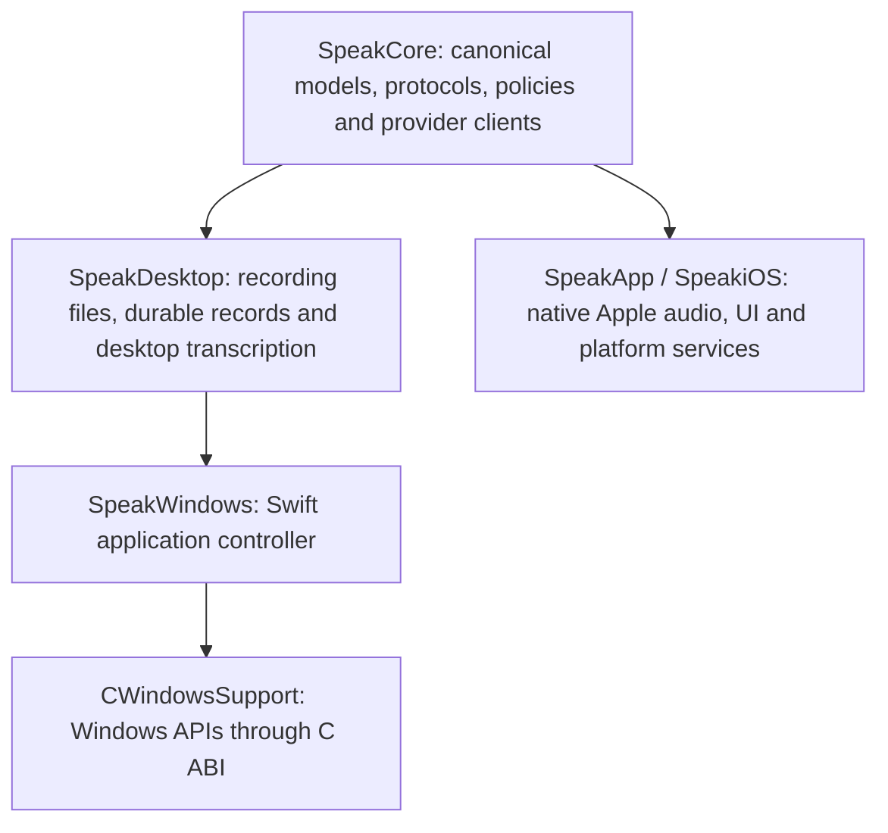

# Windows development and shared Swift core

The Windows target is an **initial native developer build, not a feature-complete
Windows release**. Feature parity with the macOS application remains the product
acceptance criterion. The current implementation does not meet that criterion.
Do not describe a successful build, test run or artifact upload as parity or
shipment.

### Native CI fixture admission

Windows synthetic controller roots (including smoke and screenshot data) use
exclusive native creation with an explicit token-user owner and protected ACL.
An elevated token's default owner can instead be a group; a Foundation-created
fixture is not evidence that native private-directory admission will accept it.
Existing paths are never taken over by the synthetic helper. Production owner,
ACL and no-reparse checks are unchanged.

Registry V1 and qualification-only V2 publish a pending handle created in their
held namespace using a simple validated basename and a NULL `RootDirectory`.
The [Windows `FILE_RENAME_INFORMATION` contract](https://learn.microsoft.com/en-us/windows-hardware/drivers/ddi/ntifs/ns-ntifs-_file_rename_information)
states: "A simple file name. (The RootDirectory member is NULL.) In this case,
the file is simply renamed within the same directory." A non-NULL root instead
causes `IopOpenLinkOrRenameTarget` to open the target directory, conflicting
with the namespace's held DELETE access. Neither namespace/ancestry access nor
sharing flags are relaxed; competing opens and namespace/History moves remain
forbidden. No absolute-path rename or operational V2 route is introduced.
Native regression source checks publication/no replacement separately from
writer and ancestry fences; source review does not qualify native execution.

The GTK container job normalizes only its three checkout ancestor directories
(`/__w`, the repository parent and checkout root) before creating `.build`
fixtures. It removes group/other write bits, preserves other mode bits, and
does not recursively change sibling mounts. Registry/capture admission still
rejects foreign-owned or writable ancestry rather than silently repairing it.

See [Desktop settings coverage](desktop-settings-parity.md) for the exhaustive
macOS preference inventory, the native portable-preferences editors and
versioned JSON transfer, and the remaining settings/engine gaps. Portable
preferences JSON is not a macOS Data & Migration backup archive.

The implementation keeps Swift for shared behaviour and uses a narrow C ABI to
Windows APIs for the desktop shell, microphone, hotkey, credentials and text
output. Apple audio, UI, local inference and security integrations retain their
native implementations. No web view or separate process is introduced into the
Apple capture path.

## Model comparison

**Transcription > Compare Models** opens a separate native editor. Select two to
eight currently supported routes, an optional language hint, and File/Batch or
Live. The file picker accepts one sample or up to 32 samples. All sources are
copied and normalized before any provider request; each sample's candidates run
independently with a 120-second deadline. Downloaded local batch models appear
only when the existing local runtime/model readiness check passes.

Live prepares the qualified shared clients before starting one WASAPI capture:
each lane must expose synchronized audio readiness, with a 12-second handshake
budget. All ready lanes receive the common 24 kHz PCM, or the same streaming
16 kHz projection, in 100 ms capture frames. Failed lanes do not cancel healthy
lanes. Stop flushes native capture and bounds each lane's finalization to 30
seconds; cancellation retains recovery text and the app-owned sample. Finalization
is an owned task, so serialized native events do not leave Cancel queued behind
Stop; shutdown also cancels that task within the existing host grace period.
Comparison capture stops at the Mac's 600-second safety limit; this is not an
audio retention limit.

Comparison uses raw results only and never inserts text, post-processes, changes
dictation settings, or writes normal History. Saved rounds and their blind order
live under `Comparisons/rounds.json`, using the canonical revision shape. Audio
and original import snapshots live under `Comparisons/Samples/`. Rank every
blind result with each rank from 1 to N exactly once (including failures) to
reveal models; standings are derived from the persisted canonical rounds.
As on Mac, fewer than two usable results reveal the evidence without fabricating
a ranking or scoreboard credit.
Candidate selection is remembered separately for File/Batch and Live, with
native **Select all ready / Select none** controls. Only qualified routes with
currently readable, non-empty canonical credentials (or a ready local runtime)
are selectable; Azure live also requires the configured resource endpoint.
Unavailable models and specific recovery reasons remain visible in the detail
pane. Their saved selections are retained, not cleared or advertised as ready.
Key writes, cloud-key imports and Azure endpoint changes refresh the editor.
Admission rechecks keys and settings after playback stops, before any sample,
client or microphone work; admitted runs retain their immutable snapshots.
Cancel or editor close invalidates pending admission, even if the editor reopens.
Native settings events queue only the admission request; its separately owned
task is cancelled on Cancel/editor close/shutdown. Cancel is not queued behind
pending playback admission.
This is configuration readiness, not evidence that a service accepts the key.
The blind **Diff against** picker reuses
`TranscriptWordDiff`; signed `[+added]` / `[-removed]` annotations remain readable
without colour and leave original transcript text untouched. Reference changes
do not judge or alter saved rounds. Word alignment is cached and computed off the
UI executor; superseded presentations cannot overwrite a newer view.
Play sample reuses native playback. JSON/Markdown exports use the canonical
SpeakCore documents through overwrite-confirming native save pickers. Choose
**All rounds** or **Selected round**, then **Save JSON / Markdown** or
**Copy JSON / Markdown**. The selected round is captured when a save picker opens;
changing selection cannot silently export a different round, and deleting it
reports an error rather than falling back to all rounds. Explicit clipboard
exports use the existing native clipboard boundary, never dictation insertion.
Exports include transcripts and model identities, even for unjudged rounds, but no audio.

Interrupted runs remain visible after relaunch; retained live audio may have
unknown duration/hash until normal finalization. Delete / discard saved round
requires native confirmation, persists a canonical deletion tombstone before
removing only its app-owned sample, and leaves original imports and normal
History untouched. Startup prunes orphan app-owned sample files, not recordings
referenced by saved rounds; no age/count retention policy is imposed.
Comparison sync is a separate explicit opt-in in this editor, using the existing
iCloud sign-in in Settings. It reuses `ComparisonSyncCoordinator` and the
canonical CloudKit Web Services round/tombstone codec. Only transcript, model,
ranking and sample metadata syncs; audio and credentials never do. Local changes
trigger an owned pass, **Sync now / retry** triggers another, and the existing
300-second web heartbeat reconciles remote changes (web clients have no native
CloudKit change notifications or documented expired-cursor error code, so
automatic cursor-expiry recovery is not claimed). Consent-off, cancellation and account changes
fence local commits/cursors/acknowledgements; network requests never run inside
the non-reentrant session gate. Comparison cursors and acknowledgements are
separate from History. Previously synced rounds/deletions stay bound to their
original account, including across relaunch; unsynced local deletions remain
local. Active microphone and queued batch rounds cannot sync or be deleted
remotely until execution releases them. Remote rounds have no playable sample
unless their app-owned audio also exists locally.
Neither Mac nor these native editors automatically retry interrupted or failed
comparison runs; sync retry retries metadata reconciliation, not providers.
The native smoke test exercises selection/action payloads, blind/revealed state,
rank/play controls, scoped copy/save payloads, explicit sync consent/retry and capture admission.
The screenshot tour also emits
`comparison-blind-light.bmp` and `comparison-revealed-dark.bmp`, independently of
page ordinals. Synthetic tests establish isolation, persistence and lifecycle
behavior, not real-provider accuracy, physical microphone/speaker acceptance,
Narrator, high contrast or multi-monitor/DPI acceptance.

## Build and run

Voice Output also offers native typed/pasted text, explicit clipboard snapshots,
editable UTF-8 file import, generation and retained replay/user-chosen lossless WAV export.
See [Desktop Voice Output sources](desktop-voice-sources.md)
for the source ownership, cancellation, privacy rules and remaining macOS gaps.

Windows CI uses **Swift 6.2.3, Windows Server 2022, x86_64**. Follow the official
[Swift Windows installation guide](https://www.swift.org/install/windows/) for
Visual Studio C++ tools, Windows SDK and Swift prerequisites. That page includes
previous Swift releases; select 6.2.3 to reproduce CI. Windows ARM64 has a
separate native workflow with native-execution evidence, described in
[Windows ARM64](windows-arm64.md). Native build, bundle execution without Swift
on PATH and developer MSIX lifecycle checks passed at `5ae80301` in
[run 36983969304](https://github.com/crmitchelmore/justspeaktoit/actions/runs/36983969304).
That receipt predates the current integration; new integration checks and physical
device acceptance remain separate.

In PowerShell from the repository root:

```powershell
swift --version
python scripts/verify-portable-core-boundary.py
swift build --configuration release --product SpeakWindows
swift test --configuration release
$bin = swift build --configuration release --show-bin-path
& (Join-Path $bin.Trim() 'SpeakWindows.exe') --self-test
& (Join-Path $bin.Trim() 'SpeakWindows.exe') --ui-smoke-test
& (Join-Path $bin.Trim() 'SpeakWindows.exe')
```

Recording feedback uses its own warmed WASAPI channel, independent of History
and Voice playback. `--self-test` and the extracted developer bundle's
`--bundle-self-test` require production Media Foundation decoding of all eight
bundled AAC cues. `--recording-feedback-self-test` requires an actual output
endpoint, exercises both cues for every profile, reusable stop and joined close,
and reports first-buffer queue admission bounded at 100 ms. This is not an
audible-latency or device-loss certification. A source-level typecheck cannot
substitute for native codec, endpoint or installed-package evidence.

The current source offers microphone recording, audio-file import and static
remote batch models across these provider families: OpenAI, Groq,
Deepgram, ElevenLabs, Google Gemini, xAI, Cartesia, Gladia, Speechmatics, Meta,
Azure, Mistral, Soniox, Rev.ai, Modulate, AssemblyAI, OpenRouter, Smallest AI,
Reson8 and StepFun. The canonical
shared catalogue owns their identifiers, metadata and routes. OpenRouter model
discovery uses the same cache and refresh policy as Apple; native model controls
refresh without changing an active recording or reusing an earlier model index.
Four OpenAI, three Deepgram, one AssemblyAI, Speechmatics, Soniox, ElevenLabs,
Mistral Voxtral, Gladia, Cartesia Ink-2, Rev.ai, two Azure Voice Live and xAI's
dedicated speech-to-text live models use shared Swift clients with the native
WinHTTP transport. Reson8 (`reson8/resonant-1-streaming`, 16 kHz PCM) also uses
the shared native transport with handshake-gated audio and a bounded,
correlated flush confirmation; Smallest AI Pulse Pro and StepAudio 3 ASR Max
are file-only routes. These additional Reson8/Smallest AI/StepFun routes have
fake-transport evidence only and no native Windows provider receipt; see
[batch transcription contracts](batch-transcription-providers.md).

Gemini Transcribe Live (16 kHz), Meta Muse realtime ASR
(24 kHz), and Modulate Velma streaming (16 kHz) now use the same injected
native transport and are projected from the canonical catalogue. Their shared
session gates audio on readiness, bounds queued plus in-flight PCM to five
seconds/256 frames, sends one frame at a time, isolates retired runs and
reports errors before returning recovery text. Gemini sends `audioStreamEnd`
and waits for trailing transcription/turn completion; Meta sends `endStream`
and waits for a new `speechComplete`; Modulate sends one WAV header per run,
drains audio, sends an empty text frame, and requires `done` before closing.
Modulate now uses the documented `platform.modulate.ai` WebSocket origin,
without relying on an HTTP redirect during the upgrade.

`DesktopLiveTranscription.makeClient(model:apiKey:language:azureEndpoint:options:makeConnection:)`
is the canonical desktop options seam. It forwards `LiveClientOptions.keywords`
to Gemini custom vocabulary, Meta keywords and dedicated xAI STT keyterms;
AssemblyAI gets its separate keyterms and stop budget/grace, Cartesia gets its
stop budget/grace, and Modulate gets its four feature flags. The existing
factory overloads and Apple `session: URLSession` constructors remain supported.
Synthetic lifecycle tests cover readiness, single-flight admission, drain,
restart, cancellation and missing completion. The loopback peer checks exact
PCM and protocol frames over Apple URLSession, WinHTTP and Linux NIO in their
native probe suites. These are not real-service, accuracy, microphone-device
or Bluetooth acceptance receipts.

Desktop live sessions also consume the same authoritative transcript projection
as macOS: whole-session revisions replace rather than append, explicit empty
snapshots retract the preview, and confirmed plus interim text is composed once.
Healthy finalisation adopts the provider's final projection; failure and
cancellation preserve recovery text and reject late updates. Clients without
an authoritative text projection retain their existing segment-folding behavior.
This establishes transcript-state behavior only. The separately source-wired
Auto-Clean candidate below builds on that projection; it has no runtime receipt.

Grok Voice also has an injected portable client, preserving manual turns,
input-only captions and the absence of `response.create`, but remains hidden
from desktop route selection. A synthetic conversation peer cannot establish
that the live service accepts the transcription-only configuration without
assistant generation or billing. Enabling it requires an opt-in native
service acceptance receipt for setup, input captions, commit completion and
no assistant output; no credentials or provider calls are used by these tests.

The xAI stream (`xai/speech-to-text-streaming`, 24 kHz PCM) is
source-wired with fake-transport tests only and still needs a Windows provider
receipt; the Grok Voice conversation route stays unavailable. Gladia
(`gladia/solaria-1-streaming`) creates its single-use session with an HTTPS
request, then streams on the WinHTTP socket that session names; the account key
never reaches the socket. Cartesia (`cartesia/ink-2-streaming`) repacks audio
into 100 ms frames, keeps the newest two seconds while its socket opens, and
after its single `close` command reads results until the server's normal
closure (1000), read from the close status the transport reports, or its
post-stop budget, then returns the whole session. Rev.ai
(`revai/machine-v2-streaming`) holds audio until the server's `connected`
message and completes a finish only on the normal closure that follows a
delivered `EOS`; a closure before `EOS`, any other status or a dropped
connection fails visibly, and its access token travels only in the socket
query, which is never logged. All three have fake-transport and synthetic
loopback tests, the latter also over WinHTTP in the probe step. Cartesia's
production handshake (`Authorization: Bearer`, `Cartesia-Version` 2026-03-01)
and its normal closure after `close` were confirmed once against the live
service on 2026-09-23 through the Apple URLSession transport, by the opt-in
`CartesiaServiceAcceptanceTests` probe (one test, no failures, 1.575 s, run by
the integrator with an existing key held in memory only). That probe streams
one second of generated silence, so it is not a Windows receipt: the WinHTTP
path against the real service and transcription accuracy remain unproven, and
none of the three has a Windows provider receipt yet. Azure Voice Live
(`azure/azure-speech-streaming` and `azure/mai-transcribe-streaming`, 24 kHz PCM)
connects only to the resource endpoint saved in Settings → Azure Speech
resource…, with no regional fallback, and leaves the language to Azure's
multilingual detection. A finish ends only once Azure acknowledges its commit
and finalisation barrier and every turn has settled; any other server error,
including one naming the barrier, is a failure. It has fake-transport tests and
synthetic loopback tests over WinHTTP in the probe step, and no Windows provider
receipt yet. A WinHTTP socket whose native
destruction cannot yet complete keeps its handles and callback context owned by
a release queue that retries with capped backoff; at four such sockets new live
connections are refused with a retryable error rather than accumulating native
state. Batch and Live retain separate model
selections. Native capture is joined before finalisation; received text and audio
survive cancellation or failure, with no automatic insertion on failure.
The global shortcut defaults to `Ctrl+Alt+Space` with press-to-toggle. The
Keyboard shortcut dialog chooses another Ctrl or Alt combination and any of the
four canonical activation styles (Press to Toggle, Press & Hold, Double Tap,
Hold & Double Tap). A combination another app or Windows already owns is refused
before the working one is released. Gesture styles report the native press and
the release, observed by polling the key only while it is held, to the shared
SpeakCore gesture machine and session policy that state the macOS rules; a
gesture stops only the kind of session it started.
The portable `DesktopPressCaptureLease` and `DesktopPressCapturePCMRelay` are
**ownership scaffolding, not an enabled microphone-on-key-press feature**.
No native worker, host handoff, preference control or permission adapter is
installed. Explicit admission separates the enabled input from qualified
capability, granted permission and idle capture ownership. Opaque tokens bind
device, route, profile and PCM format at reserve/adopt. A closing lease excludes
another open until real cleanup acknowledges; a failed close retains exclusion.
Caller cancellation or a deadline does not prove native cleanup completed.
The immutable PCM callback retains only bounded RAM before admission, switches
from rolling pre-roll to lossless bounded reservation, and reports overflow
once. One serial drain delivers outside the state lock; closing fences new PCM
and joins previously admitted delivery before worker cleanup. No per-frame actor
task, file, History record, provider, cue or insertion is introduced.
The package failure-event observer carries the generating opaque token, admitted
immutable capture identity and error, including distinct cleanup failures.
Construct it with `DesktopPressCaptureLease.observingFailures(worker:onFailureEvent:)`;
the original error-only initializer remains the only package initializer, so
its ignored-argument unlabeled trailing closures stay source-compatible.
The optional package `beginOwned` entry registers a structurally Sendable
release ticket in the same actor turn, before queued opening can run. Its
`release()` joins one token/attempt-specific result, including never-started
cancellation, late open, admitted drain and actual worker cleanup; it does not
read the global current run's failure. A cancelled waiter cannot cancel that
owned IO. Failed release remains owned and repeated calls observe the same
failure; after observing it, only explicit `retryRelease()` requests another
attempt. Owned runs reject legacy `lease.retryClose(token)` with `invalidPhase`
before any state reset or IO; the exposed token is not legacy retry authority.
Use the ticket's `retryRelease()` for owned runs. Runs admitted by legacy `begin`
retain their existing `retryClose` behavior. Workers without producer quiescence
retain immediate callback fencing before close.
Owners must retain the ticket through every terminal path; this installs no
Host startup event mapping, capture/file handoff or native worker. WAV finish
and context release still require a separately reviewed actual cleanup join.
Deferred receivers must retain that event's identity rather than tagging it with
the current recording. The compatibility observer projects only its error from
the same canonical event sink; this does not install a Host subscription.
The optional immutable PCM delivery annotates each existing drain batch with
token, identity and mono PCM16 sample-offset ranges before/after the atomic
relay reservation through `adoptDelivery`. Legacy `adopt` Data sinks still
receive that batch exactly once, including ignored-argument trailing closures.
This classifies relay admission order only: physically earlier samples
submitted later are after-reservation, not evidence of gesture/sample time.
It is not an approved Host silence clock. Legacy worker close-time partial callbacks
remain fenced; span metadata does not establish lossless native final flushing.
An explicitly conforming `DesktopPressCaptureQuiescingWorker` supplies a real
`quiesce(id:)` acknowledgement, with no default success implementation. For an
adopted run without an earlier relay failure, release keeps the SAME bounded
relay admitting final PCM until the producer has stopped and all final PCM/error
callbacks have returned. It then fences and settles admitted delivery before
`close(id:)` retires resources and before Host WAV finish/History save. During
quiescence the closing lease still excludes new runs and reserve/adopt calls.
Quiescence failure retains the first capture cause, fences delivery and still
attempts real retirement. Failed retirement retains the same owner/ticket;
explicit cleanup retry does not repeat an uncertain or completed final flush.
Native failures are latched even after the fence and synchronously published
with their original token/identity before release completion and Host disposition,
without overwriting an earlier relay cause or growing a cause list.
The original Worker open/close signatures, non-adopted release and legacy
fence-before-close path are unchanged. Package and real injected Host tests use
synthetic PCM/held acknowledgements only: no native worker conforms in production.
There is no second PCM queue, per-frame Task, new provider, factory or activation.
Actual native producer/partial-flush acknowledgement, permission/device/readiness
and physical timing still require separate implementation and qualification.
The package-only Windows owned adapter now supplies a dedicated serial I/O
executor, an actor-confined non-Sendable driver and immutable per-run callback
context. Its additive versioned C receipt separates first audio failure from
producer/final-callback acknowledgement and actual resource retirement. The
existing WASAPI framing/ring/writer are reused; each synchronous bridge copy is
bounded to one negotiated frame (at most 4,800 bytes). No per-frame Task or
second PCM queue is introduced. Partial opens and unsafe signal/join failures
retain the exact owner until real cleanup; cancellation cannot manufacture a
bounded OS-open timeout. COM cleanup remains producer-thread-affine. Failed
real event closes retain ambiguous ownership rather than retrying a possibly
reused numeric handle. Synthetic fixture entrypoints never open a microphone.
This adapter is not connected to production Effects, a factory default, the
warm setting or normal dictation handoff. Hardware-free fixture/type-check
results are not device, permission, route, physical-readiness or latency proof.
Real Windows native compilation/runtime and physical acceptance remain required
before activation; Linux healthy lossless final-tail ownership remains unavailable.

Portable fake-worker/race tests do not establish native permission, readiness,
keyboard timing or latency. Windows currently uses `RegisterHotKey` plus 15 ms
release polling, not a low-level physical-key hook; toggle mode has no paired
down/up events. macOS's `HotKeyPressPrimer` and its tests remain unchanged and
unextracted. Native wiring requires separate reviewed permission/readiness and
late-cleanup evidence before effective capability or settings exposure.

The package/internal `admitOwnedCaptureStartup` seam is explicitly injected and
has no production factory. It only prepares or abandons a startup: it never
creates a legacy active recording, starts a provider or plays a positive cue.
The separately requested `requestOwnedRecording` promotes its existing owner
through reserve, real readiness and PCM adoption into a distinct Host
`ownedRecording` descriptor, not a synchronous `Recording` adapter. The same
Lease/ticket, file owner, failure inbox and busy slot survive handoff and stop.
This capture-only route remains unavailable by default and is not production
dictation/HF/comparison/hotkey integration. Its History annotation explicitly
retains audio for retry without fabricating a transcript or completed dictation.
PCM writes use the existing bounded relay's synchronous drain and canonical
`DesktopCaptureContext.receive`, not per-frame Tasks or a second PCM queue.
Memory is bounded by the relay budget plus TWO 100 ms blocks: aligned scratch
and the canonical context's temporary Data copy, plus bounded bookkeeping.
Producer/native allocations are separate. Latched PCM failure cannot become
healthy capture; actual sink drain and native release precede single WAV finish
and save. The file actor issues only a private writer capability to that drain.
Phase revisions and release-attempt ordinals fence stale handoffs and notices.
No positive cues, provider calls, insertion, physical timestamp inference or
lossless native final-flush claim is enabled by this injected seam.
An immutable request/record slot and dedicated lease failure sink precede
`beginOwned`; the real returned ticket is retained even when failure/cancellation
arrives before delivery. A bounded FIFO failure inbox and explicit acknowledgement
barrier preserve canonical causes before disposition; unexpected overflow is
reported, not treated as success. Native release is joined by ticket/attempt,
never aggregate operation counts or legacy token retry. Failed cleanup keeps
exclusion until an explicit owned retry, including after controller close.
The file operation owns its WAV on a separate actor; file IO never runs on the
Host actor/settings queue. WAV finish is attempted once after actual release;
audio errors remain in the failed record. Failed History persistence retains
the record/file owner and busy exclusion until explicit `retryDisposition`.
Shutdown grace bounds observation only, not cleanup ownership. Closed persistence
uses the captured store without presentation. Existing synchronous normal,
hands-free and comparison capture paths and their PCM/silence behavior are unchanged.
Synthetic Host/package tests and C-stub graphs do not qualify native ownership,
permission, endpoint identity, readiness, physical timing or final-partial flush.
The source-only owned-dictation successor adds an optional injected
`DesktopHostOwnedDictationCapability` to the normal Host. Its default is nil:
the executable still selects the working synchronous legacy capture. The
unselected `WindowsNativeEffects.ownedDictationCapability` constructor composes
the real dedicated worker only from explicit capability/permission evidence;
there is no user toggle, Linux backend or automatic qualification inference.

The asynchronous session holds one immutable request (resolved profile/language,
route/device/PCM format, trigger, insertion target, output settings, provider
input, tail policy and selected live session), one History record, one WAV and
one real capture context. Normal Record/shortcut stop, Cancel, silence and close
address that same owner even while startup occupies busy bookkeeping. Successful
terminal stop enters the existing `StoppedRecording` batch/live/post-processing
and output path. Native open/quiescence/retirement never runs on the UI or
settings admission queue. Failed retirement retains the session/context/file and
exclusion until request-correlated `retryOwnedDictation`, including after close.
Shutdown grace limits observation, not ownership.

The actual Windows `hotKey` wrapper delegates to canonical Host `admitShortcut`;
the original full-await `shortcut` and `toggle` signatures remain unchanged.
`WindowsHotKeyGestures` aliases the shared
`DesktopHostShortcutGestures<WindowsHostPlatform>` classifier/serializer, so
portable fixtures drive its real recognition-ordered Task tail. With an injected
owned capability only, delivery installs a correlated startup admission and its
owned Task, then returns without awaiting microphone readiness or retirement.
Hold release and double-tap stop therefore reach an opening request while its
native open remains suspended. Direct Record/automation callers still await
startup and propagate caller cancellation to that tracked Task.

Admission freezes the resolved profile, route, language, credentials, endpoint,
configuration, target, trigger and device before playback/output/readiness
suspensions. The event's output-settings Task stays attached to that snapshot;
later settings changes cannot retag the admitted request. The startup slot
excludes other capture before a normal owner exists. Stop/Cancel/close address
both slots, and shutdown observes startup within the existing total deadline
without releasing late ownership. The unchanged Main composition still closes
the Host before draining hotkey delivery and still selects legacy capture.
The legacy serializer path retains its awaited Record/stop behavior.

Windows Record and key-down events now read a typed `DesktopHostRecordingEvent`
in settings order. It carries the resolved profile (including the effective
Auto-Clean configuration and device-local approval), output options and capture
configuration. The existing gesture tail joins that short read before Host
admission; it never waits for native readiness. A repeated key-down cannot
replace the original press's target/device/event. Owned startup uses that
configuration for silence/tail policy and the captured profile for the canonical
Auto-Clean selection, not later mutable approval or fallback-model settings.
The default legacy path consumes the same event configuration when constructing
its silence monitor, even after suspended startup work. Its tail snapshot is
bound to the committed recording ID and cleared at stop/close; a stale ID cannot
retag another recording. A present event with nil configuration means defaults,
not a fallback to later settings. Old no-event callers keep the existing
startup-time silence and stop-time tail lookup. `Recording` and its initializer
shape are unchanged, as is the original `startRecording` declaration.
Neither event capture nor preview/recovery authorizes imported preferences.
Existing profile-only and nil-event callers retain their signatures and behavior.

Windows automation status identifies an actual correlated recording/admission,
not arbitrary busy work. Start acknowledges success only after genuine owned
readiness; stop can address owned startup despite busy bookkeeping and refuses
to report success when retirement still retains that session. For owned
dictation, retained recovery text or a failed cleanup is an explicit automation
error, not successful completion. The legacy automation result policy is unchanged.
Synthetic held-delivery/profile/approval and completion-authority regressions
cover both injected owned and actual legacy capture. New default-route cases
assert executed cleanup credentials/model/History, denied-lane non-insertion,
actual silence-triggered stop, captured tail, explicit nil and no-event controls.
Credential assertions distinguish required transcription reads from optional
cleanup reads. All remain source-only, **NOT_RUN**; no native qualification or
factory activation is implied.

`DesktopPressCaptureLease.recoveringOwned` installs a narrow recovery sink before
native open. It is separate from recording adoption and is not a file-path
authority. Before adoption, the new relay retains the whole admitted startup
prefix up to the **reserved** byte budget: it does not roll away earlier audio.
The Host budgets two seconds of mono PCM16 (64,000 bytes at 16 kHz or 96,000 at
24 kHz), including any in-flight payload. Overflow rejects the whole incoming
frame and reports `startupOverflow`; an odd-byte frame is rejected as
`invalidPCM`. The first failure remains latched. These are failed recordings,
not claims that rejected samples were retained. No per-frame task or second PCM
queue is introduced.

Genuine readiness allows that single buffer to drain once through the existing
WAV/live context. A failed or cancelled pre-readiness open instead joins real
producer/callback quiescence, fences and drains admitted PCM only to the same
WAV, then retires native resources. It never feeds those bytes to a live
provider or synthesizes a successful ready/recording state. Both paths settle
delivery before single WAV finalization. A historical capture/retirement failure
continues to prevent transcription/insertion after a successful cleanup retry.
Without the new recovery authority, old lease constructors, trailing closures,
rolling pre-roll and unadopted-buffer discard semantics are unchanged.

The new portable synthetic regression sources cover startup PCM followed by an
open throw, pre-adoption cancel, delayed readiness/close, final partial PCM,
bounded overflow/partial frames, stale tickets/callbacks, cleanup retry,
single-WAV bytes/RIFF lengths, immutable request snapshots and existing normal
batch/live output. Additional fixtures drive the actual shared Windows
serializer through held-open hold release, double-tap/single-tap stop, ready
recording with later settings changes, cancellation before output resolution,
close-before-drain, and an unchanged legacy-route control. The original 23
method bodies remain intact across mechanically split files. They have
**not been compiled or executed in this source-only
slice**. This wiring is not native Windows SDK/Swift bridge, runtime, device,
warm-capture or full-parity qualification. The native C ABI/worker and Linux
healthy-terminal-tail authority are unchanged; production activation remains
unselected pending separate review and exact-source gates.

Automation is off by default. Settings → Allow automation starts a named-pipe
server, `\\.\pipe\JustSpeakToIt-SpeakApp-automation-<user SID>`. It rejects
remote clients, its DACL grants only the current user, and each client is
checked after its first bytes by impersonation: same user, not a network logon,
not below the app's integrity level. The `speak` CLI (`speak.exe`) uses the
same wire protocol, framing, command dispatch and replay coordinator as the Mac
UNIX-socket transport. It offers `status`, `history`, `transcribe`, `listen`,
`stop` and `mcp`. Automation transcription uses the remembered batch model and
never adds a History entry. Automation dictation runs the Record pipeline with
no captured field. `SPEAK_AUTOMATION_PIPE` overrides the pipe name for both
sides. Save the
selected provider's key through the application; each provider uses its canonical
credential identifier in Windows Credential Manager. The app stores settings and
durable recording records under
`%LOCALAPPDATA%\JustSpeakToIt`. A recorded file and pending history record exist
before network transcription starts, so an interrupted request does not discard
the source recording. Closing the window cancels every request and waits at
most `DesktopHostShutdown.grace` (5 s) for them; one that ignores cancellation
is left behind, cannot reach the window, and its record is recovered with its
audio at the next launch. The microphone selector persists either the Windows default
or an exact endpoint identifier; an unavailable selected device is reported
without silently switching microphones. A coalesced native subscription refreshes
the device list after connections, removals, names and default-device changes.
Snapshots are enumerated off the UI/controller and applied only when idle;
recording keeps its captured device. Missing selected devices retain an
unavailable row and recover their normal label when reconnected. See
[Windows microphone discovery](windows-microphone-discovery.md) for lifecycle,
synthetic checks and remaining hardware acceptance. Transcription and post-processing can be
cancelled while keeping audio and any completed result.

Imports are checked before copying: regular audio files, supported extensions,
non-empty and at most 25 MB. Meta and Azure accept the app's canonical 16 kHz mono PCM16 WAV directly.
Other inputs for those providers use a cancellable in-process Media Foundation
converter, retaining the original in History and removing private temporary WAV
output afterwards. The converter uses installed Windows codecs; it does not
promise support for every Ogg, Opus or WebM encoding. Native Windows decode/cancellation tests passed; run 35725040396 also decoded generated AAC/M4A and MP3 fixtures, checked their non-silent signal and retained originals.
Other compressed formats and physical-device acceptance remain pending. Canonical recordings bypass decoding after a 44-byte header probe. Azure keys accept `key:region` (a raw key defaults to eastus);
Settings → Azure Speech resource… saves the resource endpoint (as `azureSpeechResourceEndpoint`,
the Apple apps' key), which recorded audio uses when set. Mistral, Soniox and Rev.ai stream multipart bodies
from temporary files, using a native protected ACL for the current Windows user
and SYSTEM. Creation refuses existing files and reparse-point paths; completed,
failed and cancelled uploads remove their staging files. Soniox removes accepted
remote file/job resources after completion, failure and cancellation; a failed
job deletion still attempts file deletion. Rev.ai retains its existing remote-job
retention policy.

The native History pane selects saved recordings, retries batch transcription with
the recording's original model, exports transcript text through an overwrite-
confirming save dialog, and opens retained audio in its registered Windows
application. Live recordings direct users to Batch and Import for retranscription.
Retry and audio actions capture the selected record's identifier. Copy and Export
capture the displayed text and version on the UI thread, before asynchronous
work or the save dialog; a retry replacing the same saved record cannot change
their content. Selection and version events use one worker and one latest pending
value. Text, status and version render together only for the current selection;
changing selection or version clears stale text and disables Copy and Export
until the matching content is displayed. A native search box
filters the rows by original transcript, processed transcript, captured app
profile name or canonical friendly model name. Matching uses Foundation's full case folding and Latin,
Greek and Cyrillic diacritic folding through the shared `SpeakDesktop` policy,
keeps marks that spell words in other scripts, never modifies records or
transcripts, and
rows keep their stable identifiers in newest-first order. Keystrokes coalesce
into one in-flight query, so typing never queues work per keystroke. If the
selected record stops matching, its displayed text and record-bound actions
clear until the search is cleared or another row is chosen. Where a record
retains both transcripts, a Transcript version control switches the displayed
text; it defaults to the processed text, Copy and Export use the version shown
for the captured record, and Retry and Open audio always use the original
recording. Native Play/Pause, Stop and an elapsed/remaining display play the
selected recording in the app: the original file stays pinned read-only and
is decoded by the installed Media Foundation codecs to the output endpoint's
own format, then rendered through event-driven WASAPI; Open audio remains
the explicit external-player action. Playback stops before recording,
importing, switching records or closing, and hardware output remains a
separate acceptance gate. See
[Windows History playback](windows-history-playback.md). History import and
retention controls are not implemented yet.

Post-processing is disabled by default. The native Post-processing dialog can
opt into OpenRouter, choose a shared catalogue model, edit its instructions and
save a separate OpenRouter key in Credential Manager. Apply submits these
settings together. The original transcript is saved before the shared
post-processing client runs; processed text is stored separately. Empty
transcripts remain empty, and a processing failure retains the original and its
failure reason. Local post-processing is described in the parity matrix.
The source-only Auto-Clean candidate adds native Transcription preferences and
a captured per-recording cleanup lane for supported live routes through the
existing OpenRouter/downloaded-LLM adapters. Imports cannot authorize requests;
Instant adds none. Only successful authoritative-final cleanup can suppress
ordinary post-processing. Provider text, cleaned output and cleanup metadata
remain separate. See [Auto-Clean source coverage](desktop-settings-parity.md#auto-clean-candidate-source-only-validation-on-hold).
Compilation, regression execution, native UI/provider/local-runtime/device
acceptance are **NOT_RUN/on HOLD** for this candidate. Live external insertion
is not implemented or claimed.

App profiles use the canonical `DictationProfile` data model and ordered matching
policy. The native editor supports add/remove/reorder, full executable paths,
model and language overrides, post-processing mode/model/prompt and output
language. The original executable identity is captured before recording. Its
first matching profile becomes an immutable session snapshot, leaving normal
settings unchanged. Unavailable models, inherited values and Apple-only matchers
survive edits; unsupported overrides have an explicit notice retained in History.
Atomic persistence and queued settings application precede the next recording.
Spoken-language overrides reach supported live models through their shared client,
as each model's canonical capability allows: OpenAI, Deepgram Nova and multilingual
Flux, Speechmatics, Soniox, ElevenLabs, xAI speech-to-text, Gladia and Rev.ai.
Gladia's session request pins one of its documented language codes; a language it
does not list lets Gladia detect the language instead. Rev.ai's socket query
carries one of its nine documented codes (Mandarin as `cmn`); as on Apple
platforms, Automatic resolves the system language first, and a language Rev.ai
does not list is omitted, which Rev.ai reads as English, without a profile notice
yet. English-only Flux, AssemblyAI,
Cartesia Ink-2 (English only, with no language field) and Voxtral retain a
model-specific limitation; Automatic keeps the model's normal language
behaviour without a warning. Personal lexicon overrides are not applied yet.

Automatic insertion targets the control that had focus when the hotkey fired
and re-verifies the captured process, thread, foreground window and focused
control before every delivery. Native Unicode `Edit`/`RichEdit` controls
receive the text directly at the caret or over the selection. Other editable
controls (browser, Electron, XAML, WPF and Office fields) are resolved through
UI Automation on a bounded background worker: an empty field or a fully
selected field is set through the Value pattern, and everything else uses a
guarded clipboard paste that snapshots and restores the previous clipboard
content, excludes the transcript from clipboard history and reads the field
back to confirm the insertion. Password, read-only and disabled fields, a
changed focus or field, and elevated applications fail closed with a Copy
fallback message. A native **Text output** dialog chooses Smart, direct-only
or clipboard-only output, insertion at the cursor or over the whole field, and
clipboard restoration after a Smart paste. Each recording keeps the choice
saved when its Record event was queued; a later Apply affects only later
recordings. Clipboard-only output needs no captured field, so it also copies
recordings started with Record in this window, as an ordinary copy like Copy
transcript that can appear in clipboard history. See
[Docs/windows-text-insertion.md](windows-text-insertion.md) for the policy,
the deterministic native self-test and the remaining physical acceptance
gates: browser, Electron and Office insertion has synthetic coverage only.

The native-build developer artifact contains an executable, resources and
source/compiler metadata and requires installed Swift 6.2.3 and Visual C++
runtimes. The cross-build workflow also produces a separate
`windows-runtime-bundle` artifact containing an unsigned developer ZIP with the
production executable, resources, authenticated runtime DLLs, licences and
per-file hashes. That ZIP is intended to run after extraction without installing
Swift or an SDK. Its isolated runtime checks must pass for the exact revision
before this can be treated as verified distribution. See
[Windows runtime bundle](windows-runtime-bundle.md) for extraction, provenance,
search-path isolation and the negative controls. Neither artifact is a signed
installer, automatic update or supported Stable Windows release.

The same workflow's `package-lifecycle` job packs that bundle into an
**unsigned developer MSIX** with Microsoft's MakeAppx and uploads it as
`windows-developer-msix-unsigned`. On the disposable runner it is designed to
sign copies with an ephemeral test certificate, then install, launch, refuse
failed and cancelled upgrades, upgrade and uninstall while checking that
`%LOCALAPPDATA%\JustSpeakToIt` is kept. That job has not produced a Windows
receipt yet. Installing the package elsewhere needs an externally supplied
signing certificate. It is a developer identity outside the Alpha and Stable
trains; see [Windows developer MSIX package](windows-installer.md).

### Shared-core checks on other hosts

On macOS, use the Xcode Apple toolchain:

```sh
SPEAK_PORTABLE_CORE=1 xcrun swift test --configuration release
```

The normal Apple build still uses `make build` / `make test` with its established
dependency graph. The environment switch selects the portable graph only; it
also disables Apple-framework capability probes so the same unavailable-model
behaviour can be tested locally.

On Linux, install Swift 6.2.3 using the
[official Linux installation instructions](https://www.swift.org/install/linux/)
and run `swift test --configuration release`. CI uses the official
`swift:6.2.3-jammy` container pinned to its image digest. That job is the
portability gate for the libraries. The Linux desktop app (`SPEAK_LINUX_TARGET=1`)
shares the Windows controller through `SpeakDesktopHost`; see
[linux-development.md](linux-development.md).

Without `SPEAK_LINUX_TARGET` the portable graph has no external Swift package
dependencies and may remove `Package.resolved` while resolving; the Linux app
graph (SwiftNIO) rewrites it. Preserve the Apple lockfile: restore only
that file from the starting revision after portable validation, provided it had
no unrelated changes before the run. Do not commit its deletion.

The app and complete XCTest executable now **cross-compile from macOS** using a
private, pinned official Swift 6.2.3 toolchain, LLVM 20, Microsoft SDK and MSVC
libraries. The existing Xcode installation and normal Apple build graph stay
unchanged. Follow [the cross-build guide](../scripts/windows-cross/README.md).
The full app workflow copies those exact Mac-built executables to a Windows
runner and verifies their source revision and hashes before execution.
[Release cross-build run 35735185760](https://github.com/crmitchelmore/justspeaktoit/actions/runs/35735185760)
passed at `ac7b5416`: the Mac-built XCTest executable ran **378 tests, 10 optional
skips and zero failures** on Windows, and the production app passed native
self-tests and window smoke checks. The production executable is built and
copied before the separate test-enabled build; metadata verifies
`configuration=release` and `appBuiltForTesting=false`. Its SHA-256 is
`36d633960b12c80b5f3fec2b9aba4183c63ea915a6653723c08cecfc9934fe58`.
The [exact developer artifact](https://github.com/crmitchelmore/justspeaktoit/actions/runs/35735185760/artifacts/10698245839)
is an optimised cross-built app, with the runtime prerequisites described above.

After the model-specific language profiles and dedicated xAI live client were
integrated, the macOS portable suite passed **385 tests, five expected optional
loopback skips and zero failures**. This covers the combined shared source;
native Windows, full Apple and API compatibility checks must also pass for that
revision before it is promoted. It is not a live Windows xAI provider receipt.

At `dc27f528`, the full normal Apple suite passed **3,733 tests, 16 skips and
zero failures**. [Native Windows run 35741471380](https://github.com/crmitchelmore/justspeaktoit/actions/runs/35741471380)
passed **423 tests, ten optional skips and zero failures**, the five independent
WinHTTP probes, and native self/window checks. Its matching
[release cross-build run 35741471399](https://github.com/crmitchelmore/justspeaktoit/actions/runs/35741471399)
also passed. The subsequent Speechmatics integration passed **435 portable
tests, five optional skips and zero failures**; its isolated corrected source
also passed 78 focused Apple tests, including the 25 existing client tests.
Adding the corrected Soniox client brought the combined portable suite to
**466 tests, five optional skips and zero failures**. Its focused normal Apple
gate passed 160 tests. Soniox disconnects and server errors retain confirmed
text for recovery and report failure before finalisation returns; a missing
terminal response ends the finish at its deadline with the confirmed text.
Physical provider acceptance remains separate.

## Window

The window follows the Mac app's layout and look, drawn natively with Win32,
GDI+ and GDI (no web view). A sidebar lists **Speak** (Dashboard, History,
Voice Output) and **Settings** (General, Transcription, Post-processing,
Profiles, Keyboard, iCloud Sync, About); Ctrl+1 to Ctrl+0 select them in that
order. The header carries the page title with the selected model, Import audio
and Record, and the status line sits at the bottom of every page. The minimum
window is 980 × 760 at 96 DPI and scales with the monitor's DPI.

- **Dashboard**: the brand-gradient hero with Start Recording and Sessions,
  Recording Time and Spend; the displayed transcript with Copy; Insights
  (Sessions, Recording Time, Average Length, Spend) and a Setup card echoing
  the microphone, model, shortcut and text output.
- **History**: search and Import in the hero with Sessions, Errors, Average
  Length and Spend for the recordings the search shows. Each recording is an
  owner-drawn card with Created, Audio, Cost and Context badges, the transcript
  preview and the models used; failed and pending recordings are tinted. The
  selected recording's transcript, version, Play/Pause, Stop, Copy, Read aloud,
  Retry, Export and Open audio sit beside the list.
- **Settings pages** group the existing controls into titled cards, keeping
  every control identifier and behaviour: General (microphone, text output,
  and the Mac's App Behaviour card with Appearance, Launch at login and the
  local automation toggle), Transcription (source, mode, model,
  refresh, local models, keys), Post-processing, Profiles, Keyboard (the
  shortcut), Corrections, Pronunciation, iCloud Sync and About.
- Totals and row wording come from the shared `DesktopHistoryInsights` and
  `DesktopHistoryRowSummary` (SpeakDesktop), counted and formatted as the Mac
  counts them, so Windows, Linux and the Mac show the same figures.
- Colours are the brand tokens in `SpeakCore/BrandColors.swift`
  (`WindowsWindowChrome.cpp`). The window follows Windows' app mode
  (`AppsUseLightTheme`) with a dark title bar and dark common controls;
  **General › Appearance** overrides it (Follow Windows, Light, Dark), saved as
  `appearance` in `settings.json` and shared with Linux. Icons come from Segoe
  Fluent Icons on Windows 11 and Segoe MDL2 Assets on Windows 10.
- Common Controls v6 are activated from a private manifest at start-up, so the
  unpackaged executable, the bundle and the MSIX all draw themed controls.
- **Recording HUD** (`WindowsHUD.cpp`): the Mac's bottom-centre dictation
  card, with the phases, wording, per-phase clock and display times of the
  shared `DesktopHUDState` (Recording, Transcribing, Post-processing,
  Delivering, then Completed for 2.4 s or a failure for 6 s). It is a layered,
  topmost, click-through tool window that never activates, so insertion still
  reaches the captured field, drawn with GDI+ at the DPI of the foreground
  window's monitor. While recording it shows the microphone level (one atomic
  store per WASAPI frame) and the latest live words. Imports and retries never
  show it, and a late output can never finish a newer dictation's HUD.
  `--self-test` checks its styles, that the foreground window is unchanged and
  that it sits at the bottom centre of the work area.
- **Notification-area icon** (`WindowsTray.cpp`), like the Mac's menu bar
  extra: the brand icon, with a red dot while recording. Its menu shows Ready,
  Recording or Transcribing and the dashboard's Sessions, Recording Time and
  Spend, and offers Start or Stop Recording (Cancel Transcription while
  busy), Open, Settings and Quit; clicking the icon opens the window. A hidden
  window of its own owns the icon and menu, so the menu never brings the main
  window forward, and the icon returns after Explorer restarts. Closing the
  window still quits the app unless General's **App visibility** is
  **Notification area only**: then the window has no taskbar button and close
  or minimise hide it to the icon. **Taskbar only** removes the icon, and the
  compact icon drops status from its tooltip and totals from its menu (see
  [app shell](desktop-settings-parity.md#app-shell-recordings-folder-and-analytics-source-only)).
- **Launch at login** (`WindowsLoginItem.cpp`), General's switch, like the
  Mac's login item. The portable app registers `"<exe>" --background` as
  `HKCU\Software\Microsoft\Windows\CurrentVersion\Run\JustSpeakToIt`;
  turning it off in Task Manager or Settings › Apps › Startup leaves an odd
  first byte in Explorer's `StartupApproved\Run` entry, which reads as off,
  and the app's own switch turning it back on removes that entry. The MSIX
  app declares a `windows.startupTask` (off until the user turns it on, with
  the same `--background` parameter), because a packaged app's registry writes
  never reach Explorer, and reads and changes it through the WinRT
  `StartupTask` API, loaded from `combase.dll` at run time so the bundle
  imports nothing new. A task the user or a policy turned off (or a policy
  keeps on) shows a disabled switch with the note under App behaviour. The
  system's registration is the record, so the switch always shows what will
  happen at the next sign-in. A login launch shows the window minimised
  without activating it. `--self-test` exercises the registry path under a
  value of its own, never the user's; inside the MSIX lifecycle it reads the
  startup task and turns it on and off again while it is plainly off.

`SpeakWindows.exe --ui-screenshots <dir>` seeds sample History into a
throwaway data directory, visits every page, then Dashboard and History in dark
mode and a recording, and saves each as `NN-name.bmp` through `PrintWindow`;
the recording and completed HUD are drawn straight to `hud-*.bmp`.
The Windows workflow runs it after the smoke test and uploads the images as the
`windows-ui-screenshots-<sha>` artifact, so each revision's real rendering can
be reviewed without a Windows machine.

## Architecture and ownership



| Layer | Current responsibility | Source |
|---|---|---|
| Canonical domain | Model identifiers, provider routes, transcript semantics, Unicode reconciliation, lifecycle ownership, PCM/WAV, comparison and history projections | `Sources/SpeakCore/` |
| Shared batch transport | Seventeen provider routes reuse shared clients, including their HTTP, polling and cancellation behaviour | `Sources/SpeakCore/` provider clients; `Sources/SpeakDesktop/DesktopTranscription.swift` |
| Shared post-processing | Canonical cloud models, cleanup prompts, silence policy and OpenRouter execution | `Sources/SpeakCore/OpenRouterChatClient.swift`, `Sources/SpeakDesktop/DesktopPostProcessing.swift` |
| Desktop behaviour | Implemented-model projection, durable recording records, recovery, export and streaming WAV writes | `Sources/SpeakDesktop/` |
| Windows host | Native-event handling, recording orchestration, settings and credential access | `Sources/SpeakWindows/` |
| Windows services | Event-driven WASAPI capture with a bounded writer queue, native History playback through Media Foundation decoding and event-driven WASAPI rendering, native history/settings UI, hotkey, Credential Manager, clipboard, and captured-field insertion through native controls, UI Automation and a guarded paste | `Sources/CWindowsSupport/` |
| Shared sync | CloudKit record schema and codecs, History and Compare Models reconciliation, the CloudKit Web Services client and a read-only reader for the Mac's encrypted API keys | `Sources/SpeakSync/` except `appleSyncSources` |
| Desktop sync | History projection, synced copies, per-account cursors and acknowledgements, opt-in key import, build-time token resolution | `Sources/SpeakDesktopSync/` |
| Apple services | Existing SwiftUI, AVFoundation, Speech, Core ML, Keychain, CloudKit and Sparkle integrations | `Sources/SpeakApp/`, `Sources/SpeakiOS/`, native adapters in `Sources/SpeakSync/` |

`Package.swift` selects the portable graph on Windows/Linux and when explicitly
requested on macOS. New `SpeakCore` source files enter the portable build by
default. `appleCoreSources` names the existing Apple-bound dependency closure;
a new exception must be an intentional platform adapter, not a duplicate
implementation of domain behaviour. The boundary check rejects duplicate,
missing or stale exclusions and a return to a portable-source allow-list. Native
Windows/Linux CI then catches accidental Apple framework dependencies.

The catalogue remains canonical. Metadata formerly inside Meta, Cartesia,
Gladia and Speechmatics network implementations now has a shared definition;
existing public client constants forward to it. Adding or retiring a model must
update that definition and its invariants once. Windows' executable model list
is an explicit projection of transports that its application actually wires.
Catalogue membership alone is not a capability claim. In particular, do not use
the Apple on-device fallback when a Windows user's API key is missing.

Future shared policies, provider protocols, request parsing, persistence models
and transcript processing belong in `SpeakCore` or `SpeakDesktop`. Native
capture, resampling, permissions, window behaviour, secure storage, insertion,
local inference acceleration and playback belong behind platform adapters.
Keep PCM and inference in process. Do not route the hot path through JSON RPC,
a web view or disk polling merely to share orchestration.

The macOS host currently executes shared live engines for eleven remote provider
families. This includes xAI's dedicated speech-to-text route and Speechmatics
through `SharedClientLiveController`; a platform-specific client class is not
required for those routes. AssemblyAI, Cartesia, Gladia and Modulate still have
duplicate macOS transports. Cartesia and Gladia now also have shared, finalising
clients, which iOS and the Windows projection build; the macOS app still records
through its own controllers for them, and its Compare Models lanes use the
shared clients. Rev.ai has one shared client on every platform: macOS runs it
through `SharedClientLiveController`, iOS through its factory and Windows through
the desktop projection. Deepgram and OpenAI share transport but retain
separate macOS stop orchestration. These are explicit consolidation gaps:
provider changes must still inspect both paths until their adapters are migrated
and their existing capabilities and finalisation behaviour are verified.

WASAPI produces mono PCM16 directly at the selected provider's 16 or 24 kHz
rate in 20 ms frames for Deepgram and 100 ms frames for other routes. A
preallocated, single-producer/single-consumer ring holds at most 640 or 128
frames respectively (12.8 seconds, about 600 KiB at the maximum rate). Its capture-side push performs no heap allocation, mutex
acquisition or disk I/O. A separate writer invokes the Swift file callback;
stop flushes the final partial frame, drains the queue and joins the writer
before closing the recording file. Overflow stops recording with an explicit
error instead of silently dropping frames. These bounds are source guarantees,
not measured latency or microphone-device acceptance.

## Vocabulary and pronunciation journey

**Corrections** opens a native Win32 editor; Linux exposes the same fields in
its GTK page. Both support saved-entry search, add/edit/delete, durable
Up/Down ordering, canonical spellings, newline-separated spoken variants,
automatic/context/manual activation, confidence, context tags, notes and a
saved-rule preview. Context tags are explicit user input, not inferred from
an unimplemented foreground-app observer. Include-rules and include-context
preferences default to the Mac's enabled values.

`PersonalLexiconDomain` and `AutoCorrectionDomain` are the portable authorities
behind the existing Apple observation adapters. Matching is still the Mac's
case-insensitive whole-word, ordered replacement algorithm; context-ineligible
and manual rules remain suggestions rather than direct replacements. Explicit
rule order now survives save/reload on Apple as well as desktop, instead of
being alphabetised on reload. Mutations serialize with initial loading and
roll back after persistence failure; corrupt files fail closed.
`VocabularyActor` preserves MainActor isolation on Apple and uses the cooperative
executor on Windows/Linux, whose native UI loops own and block the main thread.
Native UI updates still marshal through the existing C adapter queues.
Legacy store initializers still prepare their directories synchronously. Failed
preparation is reported by the first operation, and a subsequent operation can
retry after the storage obstruction is repaired.

Recording, imported audio, retry and successful live completion apply these
rules before optional post-processing. History retains the provider transcript,
the corrected transcript, the processed result, and separate applied/suggested
records plus frozen context/directive snapshots. **Correction results** opens a
native read-only, scrollable per-record projection; it does not change text.
Original/processed version selection, Copy and Export keep their existing
displayed-version contract. Empty/silent input remains empty.

**Pronunciation** offers native add/edit/delete/order/search, word or regex,
pronunciation, optional replacement/category, regex/case flags, saved-entry
preview, canonical defaults, and JSON merge/replace/import/export. Validation
rejects duplicates, empty required values and invalid regexes before saving.
Export cannot overwrite application-state files. Read aloud takes a committed
dictionary snapshot and runs the canonical renderer once before request
segmentation, so expanded replacements also respect Deepgram's text limit.
Deepgram supports text replacements, not IPA phoneme tags; the UI says so.

Pronunciation search matches the word, pronunciation or replacement, not the
category displayed in its unchanged row label. An independent, labelled native
category filter combines with search. **All** includes unknown/imported and
uncategorized entries; other options and their whole-collection counts come
only from present `PronunciationEntry.Category.allCases` in the shared host
projection, never a platform-owned category list. Filter state is not persisted.
Updates retain the category by canonical value while it remains present, or
return to All. A filtered-out selected UUID cannot be edited, deleted or moved
until visible again; filtering never substitutes another row's identity.

Only the kind-1 presentation header is extended: fields 0-3 are unchanged,
field 4 is `pronunciationCategories.v1`, field 5 is the total entry count, and
the remainder is escaped canonical-category/count pairs in shared enum order.
Zero-count categories are omitted. Genuine four-field legacy headers support
All only. Both native consumers refuse malformed modern metadata explicitly,
including incomplete pairs, duplicate categories, invalid counts or totals
inconsistent with the unchanged eight-field rows. No C ABI, events, settings,
archive, import/apply authority or shared window controls are added by this
presentation contract.

Device-local state uses `PersonalLexicon/lexicon.json`,
`AutoCorrections/candidates.json`, `pronunciation.json` and `vocabulary.json`
under the existing private desktop application directory. Shared
post-processing directives preserve canonical confidence and suggestion/context
semantics. Lexicon keywords are forwarded through the existing xAI/Azure batch
contracts and the xAI/AssemblyAI live options contracts; unsupported routes are not given
invented hint fields.

Automatic candidate detection in other apps is **not implemented** on either
desktop host. Candidate learning/promotion/rollback machinery is shared and
tested. Native Corrections editors can review real stored candidates, inspect
counts/source apps/timestamps, promote them to durable rules, dismiss/remove
them, or clear the candidate store without clearing saved rules. There is no
fabricated edit observation, new OS-wide permission request, or inert monitoring
switch. Native form event self-tests cover
synthetic edits and previews. Native runtime, screen-reader/high-DPI use,
real microphone/import/retry, provider receipts and physical speech acceptance
must still be evidenced on the target platforms; syntax/type checks alone do
not establish full parity.

## Feature parity matrix

History's Filters button opens a modeless native editor with multi-selection
of the models used in saved transcription and post-processing, errors only,
and optional From/Through date pickers. The dates use the shared
`HistorySearchQuery` day policy in the local time zone; model/error/date
constraints compose with existing Unicode/profile search. Apply and Reset
change visibility, never recordings or transcripts. Hiding the selected row
clears its actions and stops playback and Read aloud. Native UI/device
acceptance remains required. Filtering changes no stored data; History
migration remains outstanding.

Native Delete removes the selected History entry while keeping its saved audio,
as on the Mac. Clear History confirms the complete retained-ID snapshot,
including filtered-out rows, and offers keeping audio or removing owned recording
files. Cancel is the safe default; entries arriving after confirmation are not
added to that snapshot. Delete and Clear are disabled during recording/work.
Cancelling a clear finishes the already-admitted journalled deletion and keeps
the remaining entries. Native event queues admit deletion without awaiting its
cloud request; shutdown cancels the separately owned task and uses the existing
bounded operation deadline. Selected playback, Read aloud and record-bound automatic
output are cancelled before deletion; late results cannot recreate the row.

An atomic `.history-deletions` journal is persisted before
owned audio and metadata are removed. Permanent local tombstones reject late
transcription results and synced snapshots after relaunch. Cleanup refuses
linked, shared, ambiguous or changed audio ownership; interrupted cleanup is
retried at startup, with explicit warnings while unaffected History stays visible.
Cloud deletion tickets retain their original verified account and attempt
revision. Opted-in sync drains them before reconciliation and after uploads;
failed, cancelled or consent-disabled attempts remain pending. Deleting while
History sync is disabled is local-only, even after a later opt-in. Account
rebinding never transfers an old deletion ticket to a new account.
The original keep/remove-audio choice survives cleanup retries; a later retry
cannot gain authority to remove files the user chose to keep. Audio-only
housekeeping (including previously kept files), migration/import and
custom-directory controls remain outstanding. No automatic History expiry is
introduced: the Mac has explicit audio housekeeping, not a retention limit.
Native dialog,
keyboard, accessibility, DPI and live CloudKit acceptance still require
target-platform evidence; portable tests and syntax checks alone are insufficient.

General now opens the actual recording storage folder through Explorer or the
desktop file manager. This read-only action does not alter History, expose a
different folder as a fallback, or drain a blocking shell request on the native
settings queue. Launch errors are displayed and closing bounds outstanding work.
The desktop folder contains both audio and metadata. General also confirms
deletion of saved recording audio without changing History entries, transcripts
or the History deletion journal. The confirmation freezes flat app-owned
captured/imported audio, including canonical orphan files and audio kept after a
History deletion; synthesis/conversion/comparison staging and unrelated files
are excluded. Later arrivals cannot expand its authority. Starting another
operation invalidates an outstanding confirmation.

Cleanup checks regular-file/link status and the captured size, timestamps and
available filesystem identifiers again before each removal. Detectably replaced
files are kept and individual failures are reported; cancellation leaves
unadmitted files. These are path-based checks, not an atomic native-handle
conditional deletion guarantee: identical replacements and changes between the
final check and removal remain outside that boundary. There is no automatic
cleanup retry or expiry policy; retry requires a new explicit confirmation.
Raw History playback is stopped independently of spoken/typed Voice output.
History metadata stays byte-for-byte intact; intentionally removed audio is no
longer available for playback, opening or transcription retry. A retry checks
audio ownership/availability before entering transcription, so unavailable audio
does not replace a saved transcript with a new failure. Changing the
recording location and lossless migration remain outstanding.

The existing Mac migration wire contract now lives in `SpeakCore`:
`DataMigrationFormat` retains the `JustSpeakToIt` version-1 manifest, eight
categories, explicit credential opt-in, record identities and date/selection
scopes. The Mac uses aliases to those types without changing its archive JSON.
Native migration UI, conflict previews, transactional apply/recovery and
credential installation remain separate unfinished work.

`DataMigrationCoding` and `DataMigrationPlanner` now also share the Mac codec,
conflict identities, scoped replacement, text-over-audio-only preference,
partial-category preservation and deterministic linked History/audio variants.
Mac import and `DesktopMigrationPlanner` execute this single policy; native hosts
inject the existing CNG/GLib/CryptoKit SHA-256 provider. Planning is cancellable
and fails explicitly on malformed digest output or unencodable variant values,
instead of deriving an identifier from empty-data fallback. The internal Mac
planner now throws; the import controller surfaces that error before recovery
creation or data application. A shared plan is not a native preview UI, category
validation, credential installer or durable rollback transaction.

`ApplicationPreferenceKey` is the canonical 91-key persisted application
inventory; `AppSettings.DefaultsKey` remains a Mac alias. The exhaustive
`DataMigrationPreferenceCatalog` assigns each portable key its archive value
type and category, excludes key-tracking/reconciliation markers, and includes
the existing consent, remembered-selection and credential-default auxiliaries.
Its numeric bounds and strict Boolean/string collection rules are shared;
platform shortcut/JSON validation is explicitly delegated, not silently skipped.
This also fixes Mac migration rejecting valid Boolean values for
`paidAccessRoutingEnabled`, `simpleModelChoices` and
`pasteRemoteTranscriptsAtCursor`. Archive acceptance metadata is not host
execution support: imported directories, credentials, hotkeys and unsupported
preferences still need their native validators and application adapters.

History wire values now live once in `SpeakCore` (`ApplicationHistoryItem` and
its event, error, network, trigger, prompt and diagnostic metadata). Mac keeps
source-compatible aliases and its platform-specific placeholder/presentation
extensions. Existing JSON keys, enum raw values, required arrays and optional
fields are unchanged; immutable values are `Sendable`.
`DataMigrationHistorySchema` validates the exact History/audio payload,
identifier, creation date and duration used by Mac. The shared
`DataMigrationRecordValidation` also enforces exported History/audio scopes and
emits category-prefixed preservation notices, without converting a missing
category into an empty one. Every caller must supply its real record validator;
this is not a permissive native category validator or an import/apply UI.

`DesktopMigrationHistory` maps that wire model to durable native History.
Imported duration, scalar costs without invented token counts, all model
identifiers and original Mac metadata remain available to native History,
filters, insights and playback. An optional `desktopHistory` carrier preserves
native language, profile and result metadata through Mac decode/re-export;
unknown carrier fields survive native round-trips. Canonical transcripts and
costs override stale embedded results. Imports are not CloudKit synced copies.
Shared redaction removes audio paths, network/debug payloads and recursive
carriers; audio-only values also remove transcript, prompt, correction and
failure content. JSON numbers are normalized before computing revisions, and
sub-second native timestamps remain in the carrier for stable re-export.
Record-envelope dates use the existing whole-second version-1 codec. The
collector rejects fractional scope boundaries rather than silently changing
inclusive starts/exclusive ends; native day-based selectors remain unchanged.

The actor-owned `DesktopRecordingStore.migrationSnapshot` now collects real
History and owned recording files, with exact selection/date scopes and active
audio exclusion. It fences file identity around native hashing, represents
shared audio for each retained History identity, and assigns stable separate
identities to standalone or deletion-kept audio without reviving tombstoned
History. Identifier collisions, cancellation and changed files fail explicitly.
Missing referenced audio emits preservation notices that block destructive
archive export. This collector owns only History/audio; it does not claim
settings, vocabulary, profiles, Voice or credential collection/application.

`DataMigrationArchivePolicy` also centralizes the existing Mac archive path,
entry/total/JSON-size, duplicate-path, manifest and staging-capacity rules.
Mac ZIP reads use this policy; portable tests exercise exact limits without
allocating multi-gigabyte fixtures.

`DesktopMigrationArchive` reads stored, DEFLATE and ZIP64 Mac-format exports
in process with miniz 3.1.2, pinned to commit
`77d0dce8627735138c51770d1799a1ef48f2117d`. The vendored MIT codec is compiled
with the app, with no runtime download, external archive process or handwritten
ZIP parser. `scripts/migration/verify-miniz.py` verifies LF-normalized source and
licence hashes; Windows bundles and Flatpak include its licence.
Native index allocations are capped at 128 MiB. The reader rejects duplicate
paths, unsupported manifests and malformed names, never truncates Unicode paths,
and streams only declared regular audio to generated UUID staging files.
CRC and the existing platform SHA-256 provider both verify extracted audio.
Malformed categories/items produce explicit preservation notices; cancellation
removes private staging, and failed cleanup or an unavailable digest provider
aborts explicitly. These are archive-read guarantees, not an implemented native
preview, lossless data application or recovery transaction.

`DesktopMigrationArchive.export` now writes canonical version-1 JSON and
stored ZIP64 entries through the same pinned miniz dependency. Audio is copied
in bounded chunks while its native SHA-256 is checked against the frozen
record digest; changed, linked, missing or mismatched sources abort the export.
The writer uses the reader's bounded allocator and shared incremental entry
budget, including the exact 100,000-entry, 20-GB-entry and 50-GB-total limits;
JSON retains its 128-MB limit. Incremental admission is linear, not repeated
whole-archive preflight. The required unmodified `miniz_tdef.c` comes from the
same pinned upstream commit and is included in source/licence verification;
exports intentionally use stored entries rather than recompressing audio.

The export API requires an explicit credential opt-in and refuses missing or
damaged category snapshots rather than emitting a destructive empty category.
It returns a new app-owned private staging ZIP, not a successfully published
user destination. Cancellation, I/O, hashing and cleanup failures are surfaced
and partial staging is removed. On POSIX the folder/file modes are 0700/0600.
`WindowsMigrationArchive` supplies the existing native current-user/SYSTEM ACL
adapter for both read and export. The shared Windows API refuses staging without
an explicit storage policy; inherited parent ACLs are not a privacy guarantee.
`LinuxMigrationArchive` supplies the existing native private-directory and
exclusive 0600-file adapters. Each operation owns a fresh staging directory,
creates it exclusively with private permissions and owner from the outset
(including an elevated Windows process), and creates protected empty files before
writing archive or audio bytes. Directory/file protection failures abort the
whole operation rather than becoming a successful partial import. Cancellation
after directory protection removes it before any file creation. The policy
never secures or changes the caller-selected parent folder. Hosts must use
exclusive native publication before reporting a saved export and then clean up
the owned staging folder.

`WindowsMigrationArchive.publish` and `LinuxMigrationArchive.publish` copy the
private source into protected staging on the selected destination filesystem,
using a frozen source length and 64-KiB buffers, then publish without replacing
any existing file or link. The source remains available after success,
cancellation or failure. Windows pins ancestor handles, refuses reparse paths,
denies concurrent source writers and applies the current-user/SYSTEM descriptor
before writing bytes. Linux refuses linked/nonregular/nonprivate sources and
checks source size and modification/change timestamps after copying. It prefers
anonymous `O_TMPFILE` staging; named fallback requires a current-user-owned folder
that other accounts cannot modify and `RENAME_NOREPLACE` support. Unsupported
filesystem/portal semantics fail explicitly; ordinary Linux acceptance does not
establish Flatpak destination-grant support. Both adapters check cancellation
between chunks and immediately before commit and remove only their owned
uncommitted staging. A native post-commit cleanup/durability error has a distinct
`CopyCompletionFailure`: the destination already exists and must not be deleted
or retried. Successful publication is never relabelled as cancellation.
These synchronous APIs require an owned cancellable worker, not the UI actor or
settings admission queue.

General > History backup uses a separate native ZIP save picker and an explicit
include-saved-audio choice, enabled by default. Turning it off exports History
text only; a complete History/audio export refuses missing audio rather than
silently omitting it. Settings, profiles and credentials are not included.
Settings queues admit the backup without awaiting archive I/O: an owned
cancellable off-actor worker collects the actual store, builds the archive,
publishes exclusively and removes only its owned private staging directory.
Cancel and bounded app close cancel this worker; late results cannot update a
closed window, and cancellation after commit still reports the saved backup.
GTK's chooser snapshots its audio choice, weakly holds its parent, is cancelled
on close and distinguishes dismissal from real picker failures.
Windows keeps the backup controls together in the existing Audio and output
card rather than adding an overflowing third card at its 980-by-760 minimum;
GTK uses a separate History backup preferences group in its scrollable page.

General also offers **Inspect backup** through a separate native ZIP open
picker. This is read-only archive inspection, not import approval or application:
the bounded native reader checks the envelope and extracted audio CRC/digests,
then reports canonical category counts and the number of archive notices.
History/audio records also pass cancellable canonical identity/date/scope
validation and native desktop decoding; the report separately counts
structurally valid and rejected records. Other categories are counted but
their record values are not validated. Cancellation before, between or after
records aborts validation rather than returning partial data or treating
cancellation as an invalid-item notice. The existing non-cancellable validation
API retains its behavior for other callers.
An unreadable declared category is shown as unreadable, never as an empty
successful category. Credential values and record contents are not displayed.
Native reports also include a read-only **History/audio merge preview** against
the current store, using the canonical planner and native SHA-256 adapter on the
same owned off-actor worker. Counts distinguish existing, added, updated and
retained items; conflicting versions follow the canonical non-overwriting
History/audio rules. Invalid incoming items are excluded; unreadable categories
remain unavailable rather than looking like empty merges. Missing, invalid,
duplicate or damaged current data and collector failures explicitly fail the
preview. No other category or credential is collected for this comparison.
Preview counts are not a reserved transaction or application approval:
deletion-tombstone eligibility, stale-state checks and transactional application
remain required before a future import can change data.
New exports use format version 2, with explicit record-kind coverage.
The recording-store collector selects only `history` records: the separate
native per-attempt Voice usage ledger is **not** included or converted into
Mac successful `ttsUsage` entries, and saved standalone Voice WAVs remain
independent recording-only files with no fabricated usage/History linkage.
The inspector discloses this limitation. Kind-scoped replacement preserves
unselected kinds even when their identifiers coincide; preference projections
can also restrict covered keys without clearing unsupported defaults or
uncollected vocabulary collections. Shared validation and both platform
collectors honour these selections. Legacy version-1 ZIPs remain readable.
Older version-1-only applications reject version-2 exports explicitly rather
than silently ignoring the narrower destructive scope; update the receiving
Mac app before restoring a new scoped export.
The report explicitly states that record values are not yet approved for import
and import/apply is unavailable. Its separately owned cancellable worker removes
only its reader-created private staging directory, preserves the selected ZIP
and application state, and cannot present a late report after close. The GTK
open/save chooser shares cancellation and weak-parent lifetime fencing while
keeping the selected operation and audio choice frozen. Windows posts owned
report text through its existing window dispatcher; GTK posts a native report
dialog with a single Close response.

Complete category collection, selectable configuration conflicts/application, credential recovery
and recording-location changes are not yet wired. Native CNG/GLib and Mac
ZIPFoundation interoperability tests, picker lifecycle and paired light/dark
layout acceptance remain separate required receipts. Ordinary Linux local-path
checks do not establish Flatpak destination-grant support.

Canonical History merging compares content independently of both the
application item ID and the optional `desktopHistory.id`: application of a
planned version reidentifies both through `DataMigrationHistoryValue`. A later
export/reimport must not create another version solely because that native
carrier now contains the assigned version ID. Other native/unknown carrier
fields remain significant, and raw record/schema validation still rejects a
mismatched envelope identity before planning.

The filter editor scrolls vertically when the available work area is too short;
keyboard traversal reveals the focused control. Long model names have native
horizontal scrolling, and an open editor follows application appearance changes.
Focus reveal does not relayout already-visible controls or ordinary paint
messages, so painting cannot starve timers. Native self-tests cover these paths
and verify that handling a child paint leaves its update region clean. The CI screenshot tour
requires separate light/dark filter-editor snapshots; those artifacts still need
visual review before claiming UI acceptance.

“Implemented” below describes source wiring, not completed device acceptance.
The exact CI run and target-device evidence must accompany any promotion in
status. A platform-specific replacement may provide the same user capability,
but must not be presented as the identical Apple-only engine or service.

| Feature | Windows state in this change | Remaining acceptance work |
|---|---|---|
| Window and appearance | Mac layout: sidebar pages, brand hero, Dashboard insights and setup, History cards; light, dark or follow Windows; DPI-scaled owner drawing; the recording HUD (never activated, click-through, level meter and live words); a notification-area icon and menu like the Mac's menu bar extra; General's App visibility (taskbar and notification area, notification area only, taskbar only) and compact icon, applied at launch and live; a CI screenshot tour | Physical review at 100–200% scaling and on several monitors, high contrast, Narrator over the owner-drawn cards and the HUD's announcements, the HUD over full-screen apps, the notification-area menu on Windows 10 and 11, notification-area-only mode (no taskbar button, hide on close/minimise, login launch, Explorer restart and Alt+Tab) on both, and a Windows recordings-folder choice, which waits on WindowsRecordingRegistry identity/restart integration |
| Launch at login | General's switch: the HKCU Run value for the portable app (honouring Task Manager's startup switch) and a declared `windows.startupTask` for the MSIX; a login launch starts minimised; shared state, wording and status (`DesktopHostLoginItem`, `DesktopLoginItem`). The window self-test checks the switch; `--self-test` round-trips a Run value of its own, and inside the MSIX lifecycle round-trips the startup task. Compiled against the pinned Windows SDK and run under Wine locally (the registry path and window only) | Windows CI receipt for this revision, including the packaged startup task; a physical sign-in that starts the app minimised from each; Task Manager's and Settings' switches on Windows 10 and 11 |
| Recording and file import | WASAPI PCM capture, native controls and file selection implemented | Physical microphones, device changes, permission denial, interruption and long-session recovery |
| Batch transcription | All 31 static remote models through shared clients, plus shared OpenRouter discovery and native refresh | Final-head Windows/Linux CI, real provider receipts and supported formats/languages |
| Live transcription | Four OpenAI, three Deepgram, one AssemblyAI, Speechmatics, Soniox, ElevenLabs, Mistral Voxtral, Gladia, Cartesia Ink-2, Rev.ai, two Azure Voice Live routes (to the saved resource endpoint), xAI dedicated speech-to-text, Reson8, Google Gemini, Meta Muse and Modulate use shared clients and native WinHTTP (Gladia's session request is HTTPS); Grok Voice is not exposed | Final-head native host checks and Windows provider receipts, including real xAI, Speechmatics, Soniox, ElevenLabs, Mistral, Gladia, Cartesia, Rev.ai, Azure, Reson8, Google, Meta and Modulate streams. Cartesia's handshake and normal closure are confirmed over Apple URLSession only; Rev.ai's normal closure after `EOS` follows its documentation and reconnection tutorial but has no live receipt yet; Azure's commit and barrier acknowledgements have no live receipt for the shared client yet. Shared factory/protocol fixtures are not native-provider acceptance |
| Global shortcut | Configurable Ctrl/Alt combination with conflict refusal, and all four activation styles: press-to-toggle natively; hold, double-tap and both through the shared SpeakCore gesture machine and session policy. Local Windows cross-compilation and portable gesture/policy tests pass; the native dialog, registration and release polling are covered by the window smoke test with fake registration and key state | Windows CI for this revision, physical keyboard acceptance of hold/double-tap timing, user-adjustable timing, the macOS host adopting the shared machine (it keeps its own `GestureDetector`), hands-free arming and Escape cancel |
| Text output | Captured-field insertion: native Edit/RichEdit caret/selection replacement, UI Automation Value pattern for empty or fully selected fields, guarded history-excluded paste with clipboard restore and read-back verification, field-identity and password/read-only/elevation refusal; native Text output dialog for Smart, direct-only and clipboard-only output, replace-field and clipboard restoration; each recording keeps the choice read at its Record event; clipboard-only output also copies in-app recordings as an ordinary copy | Windows CI and physical keyboard/screen reader/DPI acceptance of the dialog, physical browser/Electron/Office/XAML acceptance, undo, streaming insertion and voice edit |
| On-device transcription | Local batch recording and file import through a run-time loaded whisper.cpp 1.9.4 (best CPU variant, or Vulkan on any vendor's GPU when a driver is present). Four canonical Whisper entries (tiny, base, small, large-v3-turbo) are projected from the shared catalogue with pinned GGML files, sizes and SHA-256; the native Local models dialog downloads (resumable, atomic, verified), cancels, removes and sets the GPU choice. Source picker: Remote or Local, then Batch or Live; Local offers Batch only, so the Mode picker hides for it. Runtime DLLs are built from the pinned commit in CI and shipped in the bundle and MSIX with licence and provenance; the native job and the self-contained bundle transcribe the JFK sample with the tiny model | Windows CI receipt for this revision, local streaming, Hugging Face import, real Vulkan hardware (the runners have no GPU), CPU/GPU throughput and memory on physical PCs, and local post-processing |
| Post-processing | Separate Remote and Local choices: shared OpenRouter execution, built-in rules, and downloaded/imported local LLMs. Rendered model identifiers remain stable across native callbacks. Downloaded LLMs use the exact custom system prompt, output language and selected lexicon/context switches; built-in rules retain but do not apply those dormant controls. Local routes never use remote credentials or fall back to a cloud model. Original and processed text remain separate; empty transcripts stay empty | Combined-source compilation and regression gates, final-head Windows/Linux native UI and Apple compatibility, real OpenRouter receipts, provisioned local-runtime/model inference and cancellation/memory/performance acceptance and remaining Apple settings parity |
| Auto-Clean / Live Polish | Source-only shared per-recording latest-wins engine and native Transcription fields. Instant adds no cleanup work; capability-gated Auto-Clean captures configuration/model/key, updates in-app/HUD preview and finalizes from authoritative text after voice commands/vocabulary. Raw text and polish metadata remain separate; skip-ordinary applies only after actual success. Imported choices require local Apply; inactive tail-window value is preserved | All candidate compilation, lint, automated/native fixtures and Windows/Linux/macOS acceptance NOT_RUN/on HOLD; provider and downloaded-runtime inference/cancellation/performance receipts; safe live external insertion remains separate and unimplemented |
| Personal vocabulary | Native Corrections/Pronunciation editors; shared durable CRUD, order, validation and preview; stored-candidate review/promotion/dismissal/removal/clear; canonical correction matching before post-processing in recording/import/retry/live completion; separately retained provider/corrected/processed text and applied/suggested snapshots; native History correction results; xAI/Azure batch and xAI/AssemblyAI live keyword hints | Final-head native/Apple CI and physical editing/recording/speech acceptance; OS-wide safe edit observation |
| Profiles and settings | Native ordered per-app editor and shared validation; immutable recording overrides, model-specific live language hints and preserved unknown values | Final-head native UI, physical executable matching, remaining settings and lexicon overrides |
| History | Native record selection, case/diacritic-insensitive search over original/processed text and friendly model names, original/processed transcript selection for copy and export, retry, text export, external audio opening and in-app playback with Play/Pause, Stop and elapsed/remaining through Media Foundation and WASAPI; durable original/processed results and interrupted-recording recovery | Final-head UI smoke and device acceptance, physical speaker/Bluetooth/USB playback, history import and retention controls |
| Model comparison | Native Compare Models editor; isolated File and multi-sample Batch runs; one microphone fan-out with readiness, lane errors, bounded finalization and 600s capture safety; persisted blind rankings/reveal and canonical scoreboard/JSON/Markdown exports; confirmed delete/discard with durable tombstones, owned sample cleanup and startup orphan pruning; account/consent-fenced canonical metadata sync with explicit consent/retry. Synthetic portable orchestration/host/sync tests, native smoke checks and named screenshots | Final-head Windows/Linux native CI, physical microphone/playback, Narrator, high contrast and multi-monitor/DPI acceptance, real provider and real-account CloudKit receipts |
| Voice output | Native History-default, typed/pasted, explicit Clipboard and UTF-8 snapshots; shared Read/Generate, retained replay and chosen WAV export for executable Deepgram, Azure neural/MAI, xAI, Cartesia, Mistral, Soniox, OpenAI, Groq, canonical Gemini, Speechmatics and ElevenLabs routes. Model-qualified OpenAI/Gemini/ElevenLabs rows keep compatible tuples and voice-scoped favorites. Explicit credential-bound account evidence remains required where supported; ElevenLabs is offline presets only. Canonical language settings are provider-aware: Gemini retains regional tags in captured requests, Soniox retains its base-language/Automatic policy, and unused choices remain stored; Cartesia keeps its Automatic resolver. Quality maps OpenAI/ElevenLabs models, Cartesia/Soniox 16/24/48 kHz and Deepgram/Azure 24/48 kHz; other fixed-format routes disable unused quality, and explicit Eleven v3 stays fixed. Speed ranges: OpenAI 0.25-4, Azure neural 0.5-2, xAI 0.7-1.5, Cartesia 0.6-1.5, Soniox 0.7-1.3; others normal only. Azure neural supports whole-semitone pitch -12 to12 and SSML, MAI SSML with normal numeric controls. Native SSML Helper uses canonical Copy/Close/whole-current-draft Wrap semantics only for enabled editable SSML routes. Unsupported/unknown settings refuse before keys; immutable jobs, History-or-nil ownership, cancellation and local usage/opt-out remain shared. ElevenLabs uses genuine 24 kHz WAV and actual v4-dialogue/v3 fallback identities, not fabricated PCM headers or provider acceptance. See [contracts and limitations](desktop-voice-sources.md) | Source-only additions are uncompiled/unexecuted; the separate 48 kHz generated-audio admission repair is included in this composed source. Exact-head portable/native/Apple qualification, provider/account WAV entitlements, physical playback/microphone/Bluetooth, keyboard/screen-reader/DPI and installed-app acceptance remain required. WAV-only export: MP3/M4A and other formats/rates/decoders, progressive playback, additional canonical models, ElevenLabs account discovery, OpenRouter/system speech and broader workspace parity remain gaps. External selected text stays unavailable without a proven external captured target, including honest Wayland gating; Clipboard is never substituted |
| Hands-free and silence | Native sound-activation replacement: hotkey arm/disarm, bounded RAM pre-roll, ordinary utterance/provider/output pipeline and rearm; manual silence auto-stop; canonical native controls; WTS/power guard fails closed | Not Apple's ML detector. Physical microphone/noise/start-latency and lock/sleep acceptance, exact-head native/Apple CI, installed packages and foreground-target refresh between utterances remain unqualified; see [settings coverage](desktop-settings-parity.md) |
| Credentials | Windows Credential Manager uses canonical identifiers for the seventeen transcription provider families | Physical credential lifecycle acceptance, credential removal UI and remaining providers |
| Sync and Apple companion flows | History syncs with the Mac App Store build's CloudKit container (`iCloud.com.justspeaktoit`) through CloudKit Web Services: Settings, iCloud sync signs in with an Apple ID in the browser (loopback callback), shows Mac History as audio-less synced copies and uploads Windows History in the Mac's record format. Opt-in, read-only import of the API keys the Mac syncs, unlocked with the Mac's key-sync passphrase. Native WinHTTP transport, CNG envelope, Credential Manager for the rotating token. Portable tests and Windows loopback tests run against a fake CloudKit server; see [iCloud sync](#icloud-sync) and [Model comparison](#model-comparison) for its separate metadata sync | The CloudKit Console steps below, then a live receipt: Mac to Windows and Windows to Mac History create, edit and delete, key import, account switch and token expiry. Settings do not sync (the Mac uses the iCloud key-value store, which has no web API); iPhone History (a separate container) and Handoff are not wired |
| Automation and integrations | Opt-in `speak` CLI and MCP server over an owner-only local named pipe: status, history, file transcription, and start/stop dictation. It shares the protocol, framing, dispatch and replay with the Mac socket transport. Loopback client/server, CLI path resolution and MCP tests pass under a local Windows ABI runner. The native pipe self-test (runs in `--self-test` and CI) needs real Windows, because the local runner does not enforce first-instance ownership | Windows CI for this revision, a physical check of the General page toggle and of `speak` against a running app, packaging `speak.exe` onto PATH in the MSIX, OpenClaw, deep links, AppleScript/Shortcuts-equivalent surfaces |
| Diagnostics and insights | Dashboard and History show Sessions, Errors, Recording Time, Average Length and Spend from the shared `DesktopHistoryInsights`; shared timing and comparison data available | Timing diagnostics UI and end-to-end diagnostic receipts. Windows sends no analytics or crash reports; General's Analytics switch is stored for the Mac and gates nothing, so any future telemetry must honour it with consent/redaction |
| Distribution and updates | Unsigned developer executable, self-contained runtime bundle (including the on-device runtime), and an unsigned x64 developer MSIX with a CI install/upgrade/uninstall lifecycle job that keeps user data in the portable data directory. A CI `sign` job signs a copy with Azure Artifact Signing through GitHub OIDC once its secrets and variables exist, and otherwise logs that the unsigned package is kept ([windows-installer.md](windows-installer.md#signing)) | First Windows receipt for that job, the owner's Artifact Signing identity validation and a first signed receipt, clean physical Windows 10/11 installs, ARM64, update channel and Alpha/Stable Windows identities |

Apple-specific UI surfaces such as Siri, Live Activities, the iOS keyboard and
Apple Watch are not Windows operating-system APIs. Their relevant user journeys
must be enumerated and either supported through companion protocols or recorded
as explicit product decisions before claiming parity. They are not silently
waived by a successful Swift build.

## On-device transcription

The source now also provides explicit public Hugging Face GGML reference import
and separate verified Download in the native Local models dialog. See
[desktop Hugging Face imports](desktop-huggingface-import.md) for supported
formats, provenance, persistence and the **unexecuted** regression/native-control
evidence boundary. The earlier pinned-model receipts below do not qualify imports.

Windows transcribes recordings and imported files without a network connection
through [whisper.cpp](https://github.com/ggml-org/whisper.cpp) 1.9.4. It is
the runtime most Windows desktop speech apps already ship: it underpins
[Buzz](https://github.com/chidiwilliams/buzz),
[Vibe](https://github.com/thewh1teagle/vibe) and
[Whispering](https://github.com/epicenter-so/epicenter), has official Windows
CPU, CUDA and Vulkan builds in its
[releases](https://github.com/ggml-org/whisper.cpp/releases), and is a plain C
API that CWindowsSupport can load without Python, .NET or ONNX Runtime.
Alternatives were rejected for this slice: faster-whisper (CTranslate2) needs a
Python host and runs on the GPU only with NVIDIA CUDA; sherpa-onnx (the earlier
`codex/opus55-windows-local-runtime` draft) adds ONNX Runtime, tar.bz2
extraction and a second model format, and Windows ML/DirectML has no maintained
Whisper pipeline. The draft's shared catalogue refactor in SpeakCore is kept and
reused; its sherpa and bzip2 path is not.

- **Catalogue.** `WhisperCppModels` (SpeakCore) maps existing canonical
  `local/whisperkit/...` Whisper entries to pinned GGML files from
  `ggerganov/whisper.cpp` on Hugging Face at a fixed revision, with byte counts,
  SHA-256, licence and provenance. `LocalModelHostSupport.windows` projects the
  shared catalogue through that backend, so Windows lists only models it can
  run; distilled entries are excluded because no pinned GGML conversion exists.
- **Download.** `LocalModelInstaller` (SpeakDesktop) downloads with HTTP Range
  into a `.partial` file, resumes after a dropped connection, hashes the whole
  file with CNG, then renames it atomically and writes a receipt. A tampered or
  truncated file is deleted and never used: when the runtime loads a model it
  hashes each byte with CNG as it hands it to whisper.cpp, through one open
  file, and frees the model unused unless the digest matches the pin, so a file
  replaced or rewritten at any moment cannot supply unverified bytes. The
  cached model is reused only for the same path and digest; the host then
  deletes a refused file and its receipt. The file is read on a thread of its
  own (`WindowsModelStream.cpp`), never while the runtime holds its lock, so a
  read that stalls (a network share, a pipe) cannot keep a cancelled
  recording, or the next one, waiting; a character device is refused without
  being read. Cancelling stops a load within 1 MiB and caches nothing. At most
  four readers live at once, so readers left blocked by a source that never
  resumes cannot pile up: a load is refused until their reads return.
  Models live in `%LOCALAPPDATA%\JustSpeakToIt\LocalModels` with the owner-only ACL.
- **Runtime.** `WindowsWhisper.cpp` loads `whisper.dll` from the application
  directory with a restricted search path, refuses any `whisper_version()` other
  than the pinned one, and registers ggml backends from that directory only.
  With the GPU choice on, ggml picks Vulkan when `vulkan-1.dll` and a device are
  present, otherwise the best CPU variant. Models stay loaded between
  recordings; cancelling a recording aborts inference.
- **Removal.** `LocalModelOwnership` (SpeakDesktop) refuses to remove a model
  that a recording, import or transcription uses, which a profile may choose
  instead of the selected model, and never lets a download and a removal of one
  model overlap. `LocalModelTeardown` deletes the files, then asks the runtime to
  free its cached model on its own queue, because freeing waits for a running
  recognition; the controller stays free to cancel or record meanwhile. The
  runtime frees the model only if it was loaded from the removed file, checked
  under the lock it loads under, so a model loaded in its place stays warm.
  Deleting first is safe: the runtime closes a model's file once it is loaded.
  The controller side of downloads, readiness, recognition and removal lives
  in `SpeakDesktopHost` (`DesktopHostLocalModelManagement.swift`), shared with
  Linux; `WindowsLocalModels.swift` supplies CNG, `whisper.dll` and the dialog.
- **Controls.** The window's Source picker chooses Remote or Local above Batch or
  Live (Local has no live models yet, so Mode hides for it); Remote Batch,
  Remote Live and Local keep separate saved models. Local
  recordings skip API keys and the provider upload cap. Silent recordings stay
  empty. History and headers show the friendly name, for example "Whisper Tiny
  (on-device)". History Retry transcribes a local recording again with its own
  saved model and language, whatever the pickers show, after checking that the
  model is downloaded and the runtime can run; if not, the recording and its
  audio are left untouched and the status says why. Only genuinely live-only
  recordings get the import guidance (`DesktopHistoryRetry`, SpeakDesktop).
- **Checks.** `--self-test` covers CNG vectors, a download, resume, tamper
  and removal cycle, the controller's removal ownership with a held
  transcription and teardown and, with the runtime beside the app, a held
  import, and History Retry of on-device recordings through the real
  controller: its own model, language and audio, refusal without a model or
  runtime, and failed or silent retries keeping the recording. With the
  runtime present, the platform tests also delete a loaded model's file and
  hold a removal while another model replaces it in the cache.
  `--local-transcription-self-test <wav> --expect <phrase>`
  downloads the pinned model into `JSTI_LOCAL_MODEL_DIRECTORY` and transcribes
  the WAV; CI runs it on the native build and from the self-contained bundle
  with the JFK sample. `JSTI_WHISPER_RUNTIME_DIRECTORY` points a developer
  build at runtime DLLs outside the executable directory.

The runtime build, its pins and the bundle integration are described in
[windows-runtime-bundle.md](windows-runtime-bundle.md#on-device-transcription-runtime).

## iCloud sync

Windows joins the **Mac** CloudKit container, so a user's Mac History appears
on Windows. Only the Mac App Store build writes to that container; the direct
(Developer ID) Mac build ships without CloudKit entitlements, so its History is
not in iCloud. iPhone History lives in `iCloud.com.justspeaktoit.ios` and is a
separate container. The formats, protocol evidence and limits are in
[Windows CloudKit sync](windows-cloudkit-sync.md).

What the Windows app does:

- **Settings > iCloud sync** opens the dialog. **Sign in** asks CloudKit for
  Apple's sign-in page, opens it in the default browser (only `https` pages on
  `apple.com` or `icloud.com`), and listens on
  `http://127.0.0.1:47823/cloudkit-sign-in` for the redirect carrying
  `ckWebAuthToken`. The listener runs only during sign-in, for at most ten
  minutes, and takes the redirect only from a process of the signed-in
  Windows user and only as a top-level browser navigation (see
  [Sign-in callback](windows-cloudkit-sync.md#sign-in-callback)). The token rotates on every response and is kept in Credential
  Manager as `com.justspeaktoit/cloudkit.webAuthToken`.
- **Sync History with my Mac** turns on History sync. The app syncs at launch,
  every five minutes, after each saved transcript, and on **Sync now**.
  Transcripts from the Mac appear with "from your Mac" and refuse playback,
  opening audio and retry, because their audio stays on the Mac. When the Mac
  deletes one of them, it is removed here. When the Mac deletes a recording
  that was made on this PC, this PC keeps its own copy and audio and never
  uploads it again.
- **Import API keys my Mac syncs** is off by default. It needs the key-sync
  passphrase that was set on the Mac. Only the derived key is stored in
  Credential Manager, as `com.justspeaktoit/cloudkit.apiKeySyncKey`; the
  passphrase is not. The app imports keys only from the canonical list in
  `SyncSchema.EncryptedSecret.syncableIdentifiers`. It never writes keys to
  iCloud. A key you type yourself, in Settings or in the post-processing
  dialog, is never removed by a later deletion on the Mac, even one that
  arrives as you save it; a newer key from the Mac still replaces it, as it
  replaces any saved key. The latest choice wins: turning import off, or on
  again with another passphrase, overrides a turn-on that is still in progress.
- Sync state (the cursor, the bound iCloud user, acknowledgements and which
  keys were imported) is in `%LOCALAPPDATA%\JustSpeakToIt\CloudSync\state.json`.
  Signing out keeps it. If another Apple ID signs in, that state is reset and
  nothing on this PC is deleted; every syncable History record then uploads to
  the new account, both recordings made on this PC and transcripts downloaded
  from the previous account. That second part is open for review; see
  [Changing Apple ID](windows-cloudkit-sync.md#changing-apple-id).

The CloudKit API token is not a Mac credential. Apple apps use the operating
system's CloudKit session, and no token from them can be reused here. The API
token is created per container in CloudKit Console and compiled into Windows
builds as a build setting. A build without one shows "iCloud sync is not
available in this build" and works normally otherwise. For local development,
set `JSTI_CLOUDKIT_WEB_API_TOKEN` (and `JSTI_CLOUDKIT_WEB_ENVIRONMENT=development`
to use the Development environment) before starting the app.

### One-time setup the container owner must do

1. **Deploy the schema to Production.** In
   [CloudKit Console](https://icloud.developer.apple.com/), select the
   `iCloud.com.justspeaktoit` container, open **Schema**, and check that
   **Production** lists the record types `TranscriptionHistory`,
   `EncryptedSecret`, `EncryptedSecretMetadata` and `ModelComparisonRound`.
   If any is missing, deploy from Development with **Deploy Schema Changes…**
   and confirm. CloudKit Web Services can only see what is deployed to
   Production. The repository has no record of a Production deployment; the
   Alpha rollout checklist lists "deploy the matching CloudKit schemas" as
   outstanding evidence. Repeat for `iCloud.com.justspeaktoit.alpha` if Alpha
   builds should sync.
2. **Create the API token.** In the same container, open **Settings** (or
   **API Access** in older Console layouts), then **Tokens & Keys**, and add a
   new **API Token**:
   - Name: `Just Speak to It for Windows`.
   - **Sign in Callback**: choose **URL Redirect** and enter exactly
     `http://127.0.0.1:47823/cloudkit-sign-in`.
   - Allowed origins: leave the default. The Windows client is not a browser
     and sends no `Origin` header.
   - Save it and copy the token value.
3. **Add the CI secret.** In GitHub, open **crmitchelmore/justspeaktoit >
   Settings > Secrets and variables > Actions > New repository secret**, name
   it `CLOUDKIT_WEB_API_TOKEN`, and paste the token. The macOS to Windows Swift
   Proof workflow writes it into the build with
   `scripts/windows-cloudkit/configure-cloudkit-web.py` on pushes to `main` and
   manual runs. Pull request builds never receive it.
4. **Check the callback once.** Install a build made with the secret, sign in
   from Settings > iCloud sync, and confirm the browser lands on "Signed in".
   If Console refuses a plain `http://127.0.0.1` callback, record that in issue
   #1157: the client would then need a custom URI scheme activation through
   the MSIX manifest, which is not implemented.

## Verification and performance thresholds

[The Windows workflow](../.github/workflows/windows.yml) builds the native x64
executable in release configuration, runs shared and Windows adapter tests,
runs `--self-test`, then requires `--ui-smoke-test` to finish within 30 seconds.
It also runs release tests for the portable graph on macOS and
Linux. The actions have read-only repository permissions and require no real
provider keys.

The Windows, Windows ARM64, macOS to Windows proof and Linux workflows are
advisory: they run on pull requests and on `main`, but they are not required
checks in the `main` ruleset, and nothing else waits for them. Alpha releases
follow `CI` only. A red desktop workflow is still a regression to fix, but it
never blocks an Apple merge or release.

The native self-test checks UTF-8/UTF-16 round trips, invalid encoding, PCM frame
boundaries, silent packets, stop flushing, bounded queue overflow/wrap/FIFO/drain
behaviour, writer failure reporting and rejection of an invalid insertion
target. The text output self-test then drives the insertion adapter against
app-owned hidden Edit/RichEdit controls on a helper thread through injected
foreground, clipboard and keystroke seams: caret and selection insertion,
surrogate pairs, replace-field, stale focus and foreground, password/read-only
refusal on both the native and UI Automation paths, the Value pattern for
empty and fully selected fields, the guarded paste with exact clipboard
restoration, keystroke failure, unverifiable pastes, a clipboard changed by
another application, bounded timeouts, bounded destroy of a blocked worker and
worker cleanup. It never sends real input or touches the system clipboard, and
it is not evidence of insertion into a real browser, Electron or Office
window. The self-test also checks clipboard-only output without a captured
field on an in-memory clipboard, and runs the controller's recording, settings
and output workflow with synthetic capture, providers and output to check
that each recording keeps the text output read at its Record event. The
current UI smoke test creates a real native window and checks its
minimum-size control bounds, atomic history replacement, preserved selection,
history action identifiers, search query events with filtered-snapshot
selection clearing and restoration, transcript version defaults with copy and
export version identity, microphone selection snapshots, cancellation, a
hidden post-processing dialog's atomic Apply callback before shutdown, and the
Text output dialog's choices, Cancel/Escape/Enter, keyboard order, minimum
bounds and modal recording refusal. Profile
smoke checks cover CRUD, ordering, preservation, validation, modal hotkey refusal,
keyboard scrolling and narrow window layout. Model-list smoke checks exercise
refresh, retained selection and transition from batch-only to live-capable lists. Native
storage tests check protected ACLs, existing-file refusal and junction rejection.
The playback self-test drives the production decode, queue and render loop
against a synthetic audio engine without a speaker: exact output bytes with
no trailing silence, source position through pause/resume, cancel and the
final drain, pause before start, event timeout, device failure, immediate
completion, refused second start, callback self-destroy refusal and release
of the pinned source; the window smoke test adds record-bound playback
controls and recording lockout. Hardware playback tests probe the endpoint
explicitly and skip only the audible checks when Windows reports none.
The combined additions passed native CI at `ae61b2e8` and `ac7b5416`, and the
Mac-built release app passed at `ac7b5416`; later revisions require their own checks.
The first playback run at `71be64f2` executed 535 Windows tests with 13 optional
skips and one failure: refusing an oversized source left an input handle pinned.
The reviewed correction retains temporary ownership until validation succeeds;
a regression checks both handle ownership and whether the file can be reopened.
The standalone bundle run also found an empty-environment cleanup failure before
launch. The cleanup now handles absent Swift variables, with an actual PowerShell
regression covering empty and populated environments. Both corrected runtime
paths subsequently passed at `91479ba8`; the receipt is recorded below.
Neither executable smoke test proves physical microphone capture, live provider
transcription, successful external insertion or user-visible feature parity.
Separate adapter unit tests exercise Credential Manager with isolated synthetic
test entries; they do not validate a user's provider credentials.

Verified checkpoints on 22 September 2026:

- [Native Windows/macOS/Linux run 35734154969](https://github.com/crmitchelmore/justspeaktoit/actions/runs/35734154969)
  passed at source `ae61b2e8` (tested merge `c4e8872a`): **378 Windows tests,
  ten optional skips, zero failures**, then all five WinHTTP loopback probes,
  native self-tests and expanded window checks. This includes profiles, dynamic
  model refresh, bounded insertion and microphone hot-plug. The client snapshot
  was inspected: its controls fit without overlap. The
  [developer artifact 10696349821](https://github.com/crmitchelmore/justspeaktoit/actions/runs/35734154969/artifacts/10696349821)
  has executable SHA-256 `a1d475a0b7beedef89cb8d273b0677f1c872a9cfc415501b7dfe9a32eeb98704`.
  Mac and Linux each passed **340 portable tests, five optional skips**.
- [Windows/macOS/Linux run 35729527217](https://github.com/crmitchelmore/justspeaktoit/actions/runs/35729527217)
  passed at source `e20a085e` (tested merge `b2e46fdd`). Windows passed **360
  baseline tests, ten optional probes skipped, zero failures**, then all five
  WinHTTP runtime probes and native/storage/converter/window self-tests.
  [Developer artifact 10695526230](https://github.com/crmitchelmore/justspeaktoit/actions/runs/35729527217/artifacts/10695526230)
  includes source/compiler provenance. This checkpoint contains the shared
  OpenAI/OpenRouter implementations and profiles policy, before the later native
  profile editor, dynamic model controls and expanded insertion adapter.
- [Mac-to-Windows Foundation run 35729527364](https://github.com/crmitchelmore/justspeaktoit/actions/runs/35729527364)
  passed at the same source: the Mac-built Windows executable ran Unicode,
  Array, Codable, Data, URL, regex and atomic file assertions on Windows.
  Its SHA-256 is `05290d2d91fac670d27c688eb23500d939d1fa9c1cb6f99d697d636161e57aed`.
  This is a Foundation runtime receipt, not the full application runtime receipt.
- The full normal Apple `make test` suite at source `5a8decf6` passed **3,652
  tests, sixteen skipped, zero failures**. Focused Apple profile checks at
  `01a06c18` passed **96 tests**. The full Apple run for the combined native profiles,
  dynamic model and insertion checkpoint `0c50d046` passed **3,688 tests, sixteen
  skipped, zero failures**.
- The actual iOS Simulator app compiled and linked at `ac7b5416` with Apple
  Swift 6.2.3, iOS 26.2 and arm64: **zero errors, 74 warnings**, 55.9 seconds.
  This includes the iOS OpenAI adapters and shared OpenRouter code. The build
  used the normal Tuist project with keyboard handoff enabled and signing
  disabled; no simulator launch, device or runtime acceptance is claimed.
- Local combined portable validation passed **339 tests, five optional probes
  skipped, zero failures**; the subsequent profile review regressions passed
  **39 focused tests**. Strict SwiftLint, full Windows Swift host typecheck and
  native C++ warnings-as-errors passed. Host typecheck is supplementary: real
  Microsoft compilation found and fixed COM include and enum-ABI differences.
- A real shared-client `gpt-live-transcribe` probe sent 4.404 seconds of locally
  generated speech and received the expected words without provider errors.
  Readiness was 2,052 ms, first text 3,314 ms and finalisation 532 ms in that
  single macOS probe. These figures are not a Windows or comparative performance
  result. A later silence probe stopped at Keychain access before connecting;
  silence requalification remains unverified.
- [Native run 35732516867](https://github.com/crmitchelmore/justspeaktoit/actions/runs/35732516867)
  and [full app cross-runtime run 35732516925](https://github.com/crmitchelmore/justspeaktoit/actions/runs/35732516925)
  ran the same **376 Windows tests** at `0c50d046`, with one failure in a synthetic
  full-selection insertion case. Its capability probe used a legacy UI Automation
  client instead of the production client; `bbfdb0a8` corrected the probe without
  weakening replacement or clipboard assertions. The later native run above is
  green. The first optimised cross attempt then exposed SwiftPM's release tests
  needing testable imports. `ac7b5416` retains the production app first and builds
  the test-enabled executable separately. Local full release cross-compilation
  and [cross-runtime run 35735185760](https://github.com/crmitchelmore/justspeaktoit/actions/runs/35735185760)
  both passed: **378 Windows tests, ten optional skips, zero failures**, followed
  by native self-tests and window checks on the exact Mac-built release app.
  [Native run 35735185967](https://github.com/crmitchelmore/justspeaktoit/actions/runs/35735185967)
  also passed at the same source, including five independent WinHTTP probes.
- Earlier [run 35725040396](https://github.com/crmitchelmore/justspeaktoit/actions/runs/35725040396)
  verified generated AAC/M4A and MP3 imports through real Media Foundation,
  preserving original files and non-silent decoded samples. It also verified
  Fable's Unicode History search policy on all three platforms.

Provider contract tests use synthetic fixtures and no real provider keys. A
passing suite is not a live provider or physical-device receipt. No current
checkpoint establishes complete parity, clean-machine installation or measured
performance equivalence.

Record Windows CI and physical acceptance receipts separately, with commit,
executable hash, OS/architecture, device, input fixture, provider/model and
observed result. Consult the current workflow run for the current revision.

Before Windows feature acceptance, prove a physical microphone → provider →
transcript → intended external field journey and its cancellation/failure paths.
Before a Windows release, prove installation, launch, upgrade, retained data and
uninstallation on a clean supported Windows machine with no development tools.
An uploaded executable does not satisfy that gate.

Performance acceptance requires measurements, not a claim inferred from native
code. Preserve the same input audio and provider conditions when comparing:

- Cold/warm start to first captured audio, first partial and completed insertion;
  report distributions, including p50 and p95.
- CPU, peak memory and retained audio buffers during capture and long sessions;
  verify capture and network backpressure remain bounded.
- Stop/finalisation latency and exact retained audio/transcript contents.
- Local inference throughput, cold load and memory on supported CPU/GPU paths.
- The macOS baseline before and after shared-core refactors, with its existing
  native acceleration retained.

Record and investigate regressions before broadening availability. Shared code
is accepted only when its consumers retain correct behaviour and measured
performance on their own platforms.

The combined shared-provider and framing checkpoint passed **509 portable release
tests, five optional skips, zero failures** on 22 September 2026. It includes
ElevenLabs manual commit ordering, Soniox finalisation budgets and desktop route
projection. Soniox's macOS adapter now delegates transport and finalisation to
the same shared client while preserving native capture. Failed or cancelled
finalisation keeps visible draft text separate from provider-confirmed text.

Deepgram capture uses 20 ms Windows frames; other routes keep 100 ms. Synthetic
10/20 ms packet tests at both supported rates show first delivery at 20 ms instead
of 100 ms, preserving exact sample order and final tails. The queue retains its
12.8-second bound and 600 KiB PCM storage. This isolates application batching; it
is not a physical-device or end-to-end latency measurement.

At `9e4ac674`, the complete normal Apple `make test` suite passed **3,889
tests, 16 optional skips, zero failures**. Both macOS Soniox and ElevenLabs
controllers now use shared protocol clients while retaining native audio
capture. Their recovery adapters preserve visible drafts separately from
provider-confirmed text. The ElevenLabs outer stop watchdog captures its
shared drain bound plus the run's bounded grace and a callback-delivery margin;
healthy completion does not wait for that deadline. Deterministic tests cover
late finals, specific failures and retired timers across replacement recordings.

The subsequent integrated recovery checkpoint `d6c4bb47` passed the full normal
Apple suite: **3,900 tests, 16 optional skips, zero failures**. Strict baseline
lint passed across 1,272 files. The generic macOS host now captures provider
errors before the UI hop, preserves trailing drafts on failed finalisation,
aborts cancellation and suppresses terminal success or utterance dispatch after
reentrant cancellation. Its eleven new regressions run against the actual
controller with injected capture/client boundaries; the PCM path is unchanged.

The iOS shared host received the same recovery guarantees and reads the active
client's optional finalisation budget. **Thirty-three focused iOS Simulator
tests passed with no failures or skips**, including all nine interruption
fixtures. The old controller failed the draft-preservation and abort-contract
comparison cases. The production app compiled and linked; isolated fixtures
use existing injected services rather than constructing live CloudKit state.
The integrated portable suite passed 511 tests with five optional skips and
zero failures. These checks do not qualify physical audio or the later branch's
Windows runtime; use the exact Windows checkpoint below for that evidence.

The shared ElevenLabs client streams partials continuously and, like the former
macOS transcriber, lets the server's VAD commit segments while recording. At
stop it sends one manual commit and reads finals for a bounded 1.5-second
window; because VAD commits carry no correlation id it does not end that window
at the first final, as the former macOS transcriber did. Real-provider stop
latency requires qualification before release. The portable and Apple unit
suites do not substitute for that acceptance check.

The subsequent History correction `ca4b85c4` passed **3,903 normal Apple tests**
(16 optional skips), **514 portable release tests** (five optional skips), and
strict baseline lint across 1,274 files, all with zero failures or violations.
A deterministic delayed-event test failed before the correction; eighteen
focused History/dispatch tests, real Microsoft SDK syntax checking and the
optimised Windows cross-link passed after it. The native smoke test now exercises
the actual delayed-selection, version, row-refresh and displayed-text snapshot
paths. Its runtime receipt must come from Windows CI for the corresponding
source revision; the earlier checkpoint below predates this correction.

Verified Windows checkpoint `5aab9c5e` (22 September 2026):

- [Native Windows run 35753297954](https://github.com/crmitchelmore/justspeaktoit/actions/runs/35753297954)
  passed **580 tests, 13 optional skips, zero failures**, then all five WinHTTP
  loopback probes and native executable/window checks.
- [Mac cross-build and Windows execution run 35753297969](https://github.com/crmitchelmore/justspeaktoit/actions/runs/35753297969)
  passed **580 tests, 13 optional skips, zero failures** from the exact Mac-built
  release test executable. The production executable also passed playback,
  native/window and isolated runtime-bundle checks. Both runs tested PR merge
  `386ddeb5bbb5538c1f46cec28df343d989870e8b`; its source tree is identical to
  `5aab9c5e`.
- The [runtime bundle artifact](https://github.com/crmitchelmore/justspeaktoit/actions/runs/35753297969/artifacts/10706219200)
  contains a 30-file developer ZIP with 17 runtime DLLs. In all three isolated
  runs, the application and all 17 DLLs loaded from the extracted bundle with
  no foreign modules or missing static imports. Swift was absent from PATH,
  the working directory was empty, and the bundle path contained spaces and
  Greek characters. Removing the DLLs produced `STATUS_DLL_NOT_FOUND`; removing
  the real application resource produced exit 1.
- ZIP SHA-256: `2e92ec9c2e95ec891cc17ad22b79e6d5e00f88394d4dc01e50f64eb5cedf3316`.
  The three native/cross/bundle window screenshots were byte-identical and
  inspected for control bounds. These tests use synthetic content. The hosted
  runner had no physical output endpoint, so three audible playback cases were
  explicitly skipped; microphone, speaker/Bluetooth/USB and external-app
  insertion acceptance remain open.
